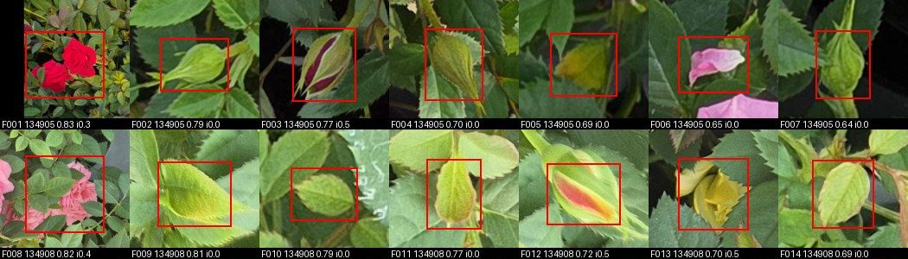
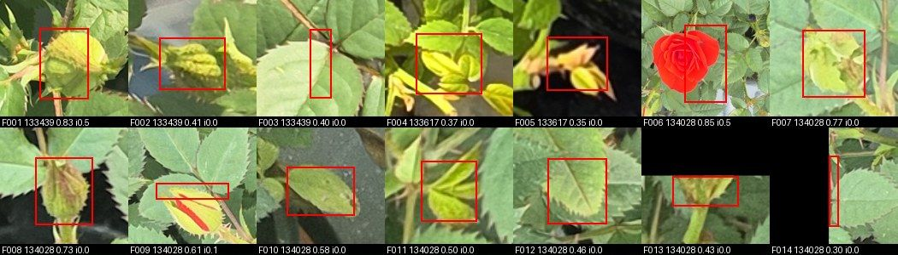
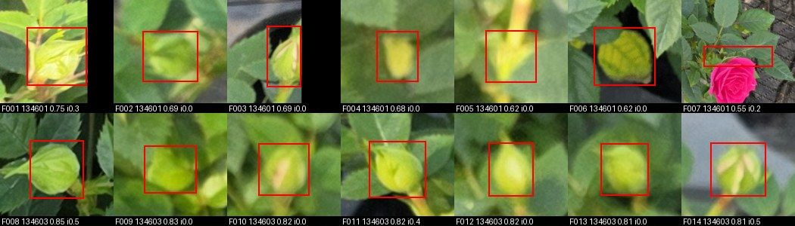
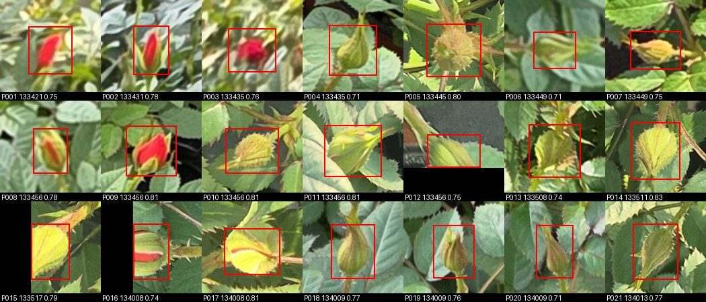
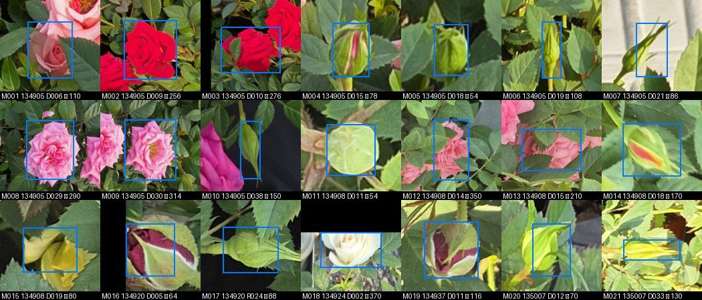
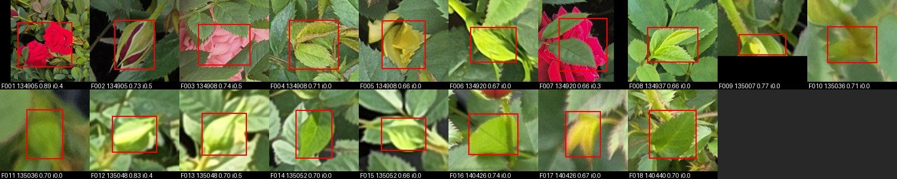
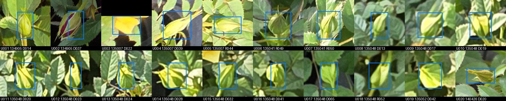
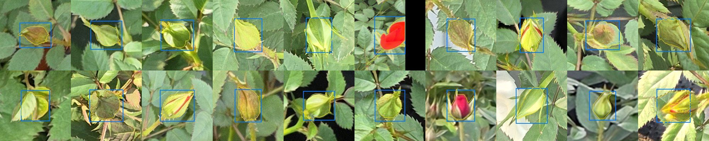
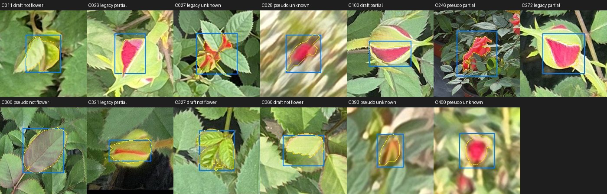
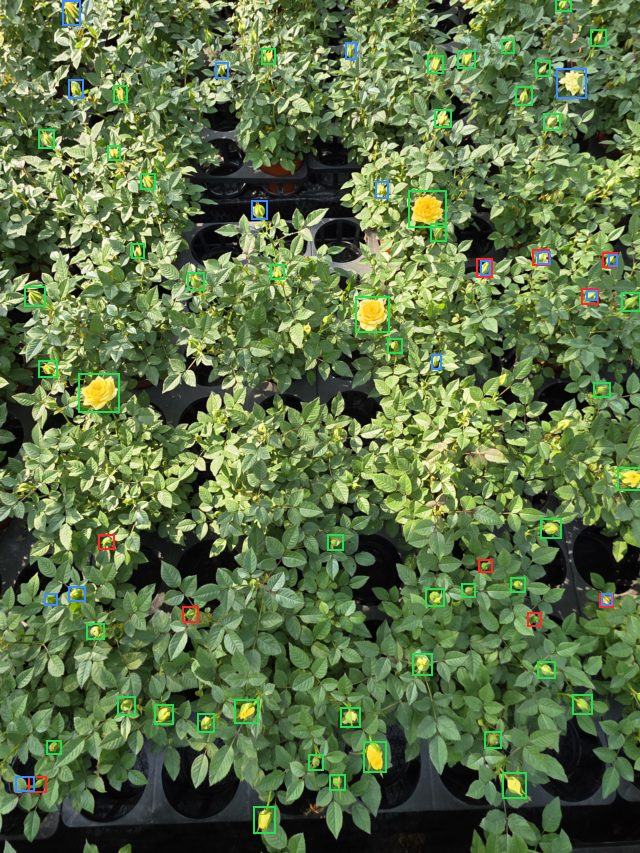

# 꽃 모델 v1 리포트: 박스 탐지와 개화 단계 분류

> 그림을 포함한 리포트: [REPORT.html](REPORT.html) (꽃 모델 버전 목록: [README](../README.md))

| 항목 | 내용 |
|---|---|
| 유형 | 데이터 + 모델 (꽃 모델의 첫 버전) |
| 작업일 | 2026-11-02 ~ 04 |
| 후보 모델 | `det/third_pseudo` + `cls/effnetv2s_r2` |
| 상태 | **후보 선정, 최종 확정 전** (모델 결정과 ESP32 평가 남음) |
| 옛 이름 | `v11_flower` |

## 요약
- 농장 사진 143장 중 133장으로 꽃을 찾고 개화 단계를 판정하는 2단계 모델을 처음 만들었습니다.
- 후보 조합의 test 탐지 F1은 0.894, 단계까지 맞힌 매크로 F1은 0.744입니다.
- 라벨이 일부만 있던 train 95장에 임시 라벨을 더한 결과, 재현율은 0.689 → 0.864, 사진당 봉오리 개수 오차는 9.29 → 2.35, 정밀도는 0.948 → 0.926입니다. 판정으로 추가한 라벨에 `third_pseudo`의 박스가 들어 있어 이 비교는 `third_pseudo`에 유리합니다.
- **요청받은 세그멘테이션과 ID 구조가 아닙니다.** 박스별로 바로 분류하며, 세그멘테이션과 ID는 `v2_seg`에서 구현합니다.

**휴대폰 사진 기준입니다. 하루, 한 농장에서 찍었고 큐브 내부 ESP32 사진으로는 평가하지 않았습니다. 타일 크기 1280도 2000×1500 사진에서 다시 확인해야 합니다.**

## 구조
사진 → 1280 타일과 전체 축척을 640으로 → YOLO26s 박스 탐지 (`flower` 1클래스) → 원본 좌표로 합치기 → 긴 변 1.25배 정사각 크롭 → EfficientNetV2-S → 봉오리 / 개화중 / 만개

세그멘테이션과 ID는 없습니다. 예측은 박스 목록이고 분류는 박스마다 바로 합니다.

## 데이터
| 분할 | 봉오리 | 개화중 | 만개 | 합계 |
|---|---:|---:|---:|---:|
| test 17장 | 473 | 33 | 44 | 550 |
| val 8장 | 246 | 21 | 25 | 292 |
| train 13장 (전체 라벨) | 349 | 20 | 11 | 380 |
| train 95장 (일부 라벨) | 831 | 85 | 57 | 973 |

| 대상 | 판정 수 | 반영 |
|---|---:|---|
| test 오류 시트 | 오탐 92, 미탐 141 | 봉오리 42개, 개화중 1개 추가, 잎 8개 삭제, 제외 영역 24개, 단계 수정 1개 |
| val 오류 시트 | 오탐 87, 미탐 29 | 봉오리 28개 추가, 잎 7개 삭제, 제외 영역 18개, 박스 교체 3쌍 |
| train 13장 오탐 시트 | 121 (전체 123) | 봉오리 37개 추가, 제외 영역 19개 |
| 임시 라벨 표본 | 100 | 봉오리 94개 추가, 제외 영역 5개, 차단 1개 |
| test 2차 오류 시트 | 오탐 86, 미탐 81 | 봉오리 43개 추가, 잎 3개 삭제, 제외 영역 9개 (그중 1개는 다시 라벨로), 단계 1개 수정 |
| `v2_seg` 오탐 시트 | 오탐 18 | 봉오리 1개 추가, 제외 영역 5개 |
| `v2_seg`만 놓친 라벨 시트 | 35 | 32칸 유지, 단계 1개 수정, 제외 영역 2개 |
| train 라벨 표본 | 400 | 맞음 387, 아직 라벨에 반영하지 않음 |

## 라벨링: Claude 검수 후 사람 판정
- **1. Claude 초안:** Claude가 사진을 격자로 나눠 보고 박스와 단계를 적습니다 (`draft`).
- **2. 규칙 확인:** 작은 봉오리 포함, 개화중과 만개의 경계, 둥근 초록 대상은 봉오리, 꽃자리 없음 등은 사용자가 정했습니다.
- **3. 사진 전체 검수:** 사용자가 test 17장을 사진 단위로 봤습니다. 수정 없이 통과해 `verified`가 됐습니다.
- **4. 오류 시트 제작:** 모델이 틀린 곳을 스크립트가 번호 칸으로 잘라 줍니다. Claude는 시트를 먼저 보고 인상을 적지만, **이 인상으로 라벨을 바꾸지 않습니다.**
- **5. 사람 판정:** 사용자가 칸마다 봉오리, 꽃, 잎, 알수없음 등을 판정합니다. 라벨 수정의 근거는 이 판정입니다.
- **6. 반영과 재평가:** Claude가 칸 수를 시트와 맞춘 뒤 스크립트로 라벨에 반영하고, 평가를 다시 돌립니다. 판정 원본은 `labels/review_*.json`과 `review_*_errors_*.csv`에 남습니다.
- **7. 학습 라벨 표본 확인:** 평가 라벨만이 아니라 train 라벨도 표본으로 사용자가 확인합니다.

### 사용자가 한 작업
| 날짜 | 사용자가 한 일 | 규모 | 결과 |
|---|---|---:|---|
| 11-02 | 구조와 라벨 규칙 결정 | 규칙 아래 참고 | 꽃 모델을 잎과 분리, 봉오리 판정 기준 확정 |
| 11-03 | test 사진 단위 검수 | 사진 17장 | 수정 없음, `verified`로 표시 |
| 11-03 | test 1차 오류 시트 판정 | 233칸 | 봉오리 42개, 개화중 1개 추가, 잎 8개 삭제, 제외 영역 24개 |
| 11-03 | `F006`, `M004` 단계 질문에 답함 | 2건 | 둘 다 개화중으로 처리 |
| 11-03 | train 13장 오탐 시트 판정 | 121칸 | 봉오리 37개 추가, 제외 영역 19개 |
| 11-03 | val 오류 시트 판정 | 116칸 | 봉오리 28개 추가, 잎 7개 삭제, 제외 영역 18개 |
| 11-03 | 임시 라벨 표본 판정 | 100칸 | 봉오리 94, 알수없음 3, 잘림 2, 잎 1 |
| 11-04 | 중복 라벨 삭제 승인 | 10쌍 | Claude가 찾고 그림 확인 뒤 삭제 |
| 11-04 | v1 test 오류 시트 판정 (2차) | 167칸 | 봉오리 43개 추가, 잎 3개 삭제, 제외 영역 9개, 단계 수정 1개 |
| 11-04 | v2 오탐 시트 판정 (3차) | 18칸 | 봉오리 1개 추가, 제외 영역 5개 |
| 11-04 | v2만 놓친 라벨 판정 (4차) | 35칸 | 32칸 유지, 단계 수정 1개, 제외 영역 2개 |
| 11-04 | train 라벨 표본 확인 | 400칸 | 맞음 387칸, 아직 미반영 |

### 사용자가 정한 라벨 규칙
- **대상:** 사진 속 모든 꽃. 작은 봉오리, 초록 봉오리, 흰 꽃을 포함합니다.
- **단계:** 봉오리는 꽃잎이 닫힘, 개화중은 풀리기 시작해 컵이나 나선 모양, 만개는 활짝 펴져 납작하거나 수술이 보임. 개화중과 만개의 경계는 사용자가 확인했습니다.
- **둥근 초록 대상:** 이 농장 사진에는 꽃자리가 없으므로 봉오리로 표시합니다.
- **제외 영역:** 흐리거나 가려 판단이 어렵거나, 사진 가장자리에서 크게 잘린 꽃입니다.
- **데이터 분할:** 사진을 다른 사람이 다른 각도로 찍었어도 train과 val에 그대로 둡니다. 큐브 안 상태 확인이 목적이고 실제 검증은 ESP32 사진으로 합니다.

### 회차별 작업과 화면
#### test 사진 단위 검수
사진 전체에 라벨을 그려 보여 주면 사용자가 사진마다 확인했습니다. **수정 없이 통과했지만**, 뒤의 칸 판정에서 빠진 봉오리와 잘못된 라벨이 더 나왔습니다.

#### test 1차 오류 시트 (`det/first`, 233칸)
모델의 오탐과 미탐을 번호 칸으로 잘라, 칸마다 봉오리, 꽃, 잎, 알수없음, 일부 등을 판정했습니다. 오탐이 봉오리면 라벨을 추가하고(같은 꽃의 라벨이 있으면 유지), 미탐이 잎이면 라벨을 지웠습니다.

#### train 13장 오탐 시트 (121칸)
`det/first`가 train 13장에서 찾았지만 라벨이 없는 칸을 판정했습니다. 임계값 0.3까지 넓혀 봤습니다. 미탐 시트 23칸은 판정하지 않았습니다.

#### val 오류 시트 (116칸)
test와 같은 방식입니다. 일부로 판정한 미탐과 봉오리로 판정한 오탐이 같은 꽃인 3쌍은 모델 박스로 바꿨습니다.

#### 임시 라벨 표본 (100칸)
라벨이 부족한 train 95장에 넣을 모델 예측에서 100칸을 뽑아 판정했습니다. 꽃이나 봉오리인 비율은 96%입니다. 봉오리는 라벨로 옮겼고, 잎은 다시 임시 라벨이 되지 않게 막았습니다.

#### test 2차 오류 시트 (`det/third_pseudo`, 167칸)
새 모델의 오류를 다시 판정했습니다. 오탐 봉오리 66칸 중 43칸은 라벨이 빠진 봉오리, 23칸은 라벨이 있는데 박스만 어긋난 봉오리였습니다.

#### test 3차, v2 오탐 시트 (18칸)
2차 판정이 v1의 오류만 본 것이라 v2의 오탐도 판정했습니다. 빠진 봉오리는 1개뿐이었습니다.

#### test 4차, v2만 놓친 라벨 (35칸)
v1은 찾고 v2만 놓친 라벨 중 칸 판정이 없던 것을 모델 예측 없이 보여 줬습니다. 잎은 없었고, 33칸은 꽃이나 봉오리로 유지됐습니다.

#### train 라벨 표본 확인 (400칸)
번호 목록을 적는 대신 **브라우저 화면에서 틀린 칸만 누르는 방식**으로 바꿨습니다. 누를 때마다 서버에 저장되어 중간에 멈춰도 됩니다.

### train 라벨 표본 결과
| 표본 | 칸 | 맞음 | 아님 | 알수없음 | 일부 | 마스크 불량 | 맞음 비율 | 95% 구간 |
|---|---:|---:|---:|---:|---:|---:|---:|---:|
| 임시 라벨 40px 미만 | 10 | 8 | 0 | 2 | 0 | 0 | 80% | 49~94% |
| 임시 라벨 40~60px | 60 | 59 | 0 | 1 | 0 | 0 | 98% | 91~100% |
| 임시 라벨 60~80px | 80 | 80 | 0 | 0 | 0 | 0 | 100% | 95~100% |
| 임시 라벨 80~160px | 40 | 40 | 0 | 0 | 0 | 0 | 100% | 91~100% |
| 임시 라벨 160px 이상 | 10 | 8 | 1 | 0 | 1 | 0 | 80% | 49~94% |
| `legacy` (Claude 썸네일 판정) | 100 | 96 | 0 | 1 | 3 | 0 | 96% | 90~98% |
| `draft` (Claude 초안) | 100 | 96 | 3 | 0 | 1 | 0 | 96% | 90~98% |

- **방법:** 사용자가 확인한 적 없는 train 라벨에서 400칸을 뽑아, 출처를 숨기고 박스와 마스크를 함께 보여 줬습니다. 틀린 칸만 누르고, 쪽을 넘길 때 나머지를 맞음으로 기록했습니다. 임시 라벨은 v2가 약한 40~80px를 많이 뽑았으므로 전체 비율이 아니라 구간별로 봐야 합니다.
- **결과:** 400칸 중 387칸이 맞음입니다. 틀렸다고 표시한 칸은 아님 4, 알수없음 4, 일부 5칸이고, 마스크 불량과 단계 수정은 없습니다.
- **v2 약점과의 관계:** v2가 가장 약한 60~80px 임시 라벨은 80칸 모두 맞음입니다. 이 크기의 박스와 마스크가 눈에 띄게 틀려서 v2가 놓친다고 보기는 어렵습니다.
- **알 수 있는 범위:** 이미 있는 라벨이 맞는지만 봤습니다. 라벨 없이 빠진 봉오리는 이 확인으로 알 수 없습니다. 틀린 칸만 누르는 방식이라 놓친 오류가 있을 수 있고, 마스크는 200px 칸에서 큰 오류만 보입니다.
- **반영:** 13칸은 아직 라벨에 반영하지 않았습니다. v3 데이터를 만들 때 함께 고칠 예정입니다.

### 판정 수 집계
| 판정 대상 | 시트를 만든 모델 | 봉오리 | 꽃 | 맞음 | 잎, 줄기 | 알수없음 | 일부, 잘림 | 칸 수 |
|---|---|---:|---:|---:|---:|---:|---:|---:|
| test 1차, 오탐 | `det/first` | 52 | 4 | 0 | 22 | 4 | 10 | 92 |
| test 1차, 미탐 | `det/first` | 106 | 10 | 0 | 8 | 10 | 7 | 141 |
| val, 오탐 | `det/first` | 35 | 1 | 0 | 32 | 13 | 6 | 87 |
| val, 미탐 | `det/first` | 14 | 4 | 0 | 7 | 1 | 3 | 29 |
| train 13장, 오탐 | `det/first` | 48 | 1 | 0 | 39 | 14 | 19 | 121 |
| 임시 라벨 표본 | `det/second` 예측 | 94 | 0 | 0 | 1 | 3 | 2 | 100 |
| test 2차, 오탐 | `det/third_pseudo` | 66 | 2 | 0 | 13 | 3 | 2 | 86 |
| test 2차, 미탐 | `det/third_pseudo` | 65 | 9 | 0 | 3 | 3 | 1 | 81 |
| test 3차, 오탐 | `v2_seg` `seg/first` | 4 | 3 | 0 | 6 | 4 | 1 | 18 |
| test 4차, v2만 놓친 라벨 | `v2_seg` `seg/first` | 32 | 1 | 0 | 0 | 0 | 2 | 35 |
| train 라벨 표본 | 라벨 자체 (출처 숨김) | 0 | 0 | 387 | 4 | 4 | 5 | 400 |
| 합계 |  | 516 | 35 | 387 | 135 | 59 | 58 | 1190 |

- **사용자가 판정한 칸은 모두 1190개입니다.** test 17장 사진 검수와 라벨 규칙 결정은 이 수에 들어 있지 않습니다.
- **칸 판정이 사진 검수보다 많이 찾았습니다.** test 17장은 사진 검수에서 수정이 없었지만, 칸 판정으로 빠진 봉오리 86개(1차 42, 2차 43, 3차 1)를 추가하고 잎 11개(1차 8, 2차 3)를 지웠습니다.
- **Claude의 판단도 사람이 고쳤습니다.** 2차에서 Claude가 잎처럼 보인다고 적은 `M020`~`M023`은 모두 봉오리였습니다.
- **판정에서 걸러지지 않은 오류도 있었습니다.** Claude 초안의 중복 박스 10쌍은 사진 검수를 통과했고, ID 결과를 라벨과 맞춰 보다가 뒤늦게 찾았습니다. 사용자 승인 후 지웠습니다.
- **판정한 번호는 그 회차 시트의 번호입니다.** 회차마다 번호가 새로 매겨지므로 다른 회차의 같은 번호와는 다른 칸입니다.

### 칸별 판정
- test 1차, 오탐, 봉오리 (51): F002, F003, F004, F007, F012, F020, F022, F023, F024, F030, F031, F032, F036, F042, F043, F044, F045, F046, F047, F048, F049, F050, F051, F052, F053, F054, F055, F057, F058, F059, F060, F061, F063, F064, F066, F069, F070, F071, F074, F076, F078, F079, F082, F083, F084, F086, F087, F088, F089, F090, F092
- test 1차, 오탐, 잎 (22): F005, F009, F010, F011, F014, F015, F016, F017, F018, F019, F025, F027, F028, F033, F038, F040, F041, F056, F067, F075, F077, F085
- test 1차, 오탐, 꽃 일부와 잎 (5): F021, F026, F035, F037, F072
- test 1차, 오탐, 알수없음 (3): F062, F065, F068
- test 1차, 오탐, 봉오리 일부 (2): F039, F073
- test 1차, 오탐, 꽃 2개 (1): F001
- test 1차, 오탐, 개화중 (개화된 꽃의 옆모습) (1): F006
- test 1차, 오탐, 잎에 가려진 꽃 (1): F008
- test 1차, 오탐, 잎에 가려진 봉오리 (1): F013
- test 1차, 오탐, 제외 (1): F029
- test 1차, 오탐, 꽃 (1): F034
- test 1차, 오탐, 봉오리 우측 이미지 일부 (1): F080
- test 1차, 오탐, 봉오리 좌측 이미지 일부 (1): F081
- test 1차, 오탐, 봉오리 하단 일부 (1): F091
- test 1차, 미탐, 봉오리 (104): M005, M008, M009, M010, M011, M012, M013, M014, M015, M019, M021, M023, M024, M025, M028, M029, M031, M032, M033, M034, M035, M036, M037, M038, M039, M042, M043, M044, M045, M046, M047, M048, M049, M050, M051, M052, M054, M055, M056, M057, M059, M060, M063, M064, M065, M066, M067, M068, M069, M071, M072, M078, M079, M080, M081, M082, M083, M084, M085, M087, M088, M090, M091, M092, M093, M094, M095, M097, M098, M099, M100, M102, M107, M108, M112, M113, M114, M115, M116, M117, M118, M119, M120, M121, M122, M123, M124, M125, M126, M127, M128, M129, M130, M131, M132, M133, M134, M135, M136, M137, M138, M139, M140, M141
- test 1차, 미탐, 알수없음 (10): M058, M061, M070, M073, M075, M076, M077, M086, M089, M096
- test 1차, 미탐, 잎 (8): M006, M016, M030, M040, M041, M103, M104, M106
- test 1차, 미탐, 꽃 (5): M002, M003, M022, M026, M027
- test 1차, 미탐, 잎에 가려진 꽃 (3): M001, M017, M018
- test 1차, 미탐, 꽃 일부 (3): M007, M074, M109
- test 1차, 미탐, 개화중 (2): M004, M101
- test 1차, 미탐, 잎에 가려진 봉오리 (2): M020, M110
- test 1차, 미탐, 봉오리 우측과 잎 (1): M053
- test 1차, 미탐, 봉오리 일부 (1): M062
- test 1차, 미탐, 봉오리 우측 일부 (1): M105
- test 1차, 미탐, 봉오리 좌측 일부 (1): M111
- val, 오탐, 봉오리 (35): F001, F002, F003, F008, F010, F011, F012, F013, F014, F015, F016, F017, F018, F019, F025, F026, F031, F032, F033, F040, F045, F054, F056, F057, F058, F059, F060, F061, F063, F071, F080, F082, F083, F084, F085
- val, 오탐, 잎 (32): F020, F024, F027, F028, F034, F036, F038, F039, F044, F047, F048, F049, F050, F051, F052, F053, F055, F064, F065, F066, F067, F069, F070, F072, F075, F076, F077, F078, F079, F081, F086, F087
- val, 오탐, 알수없음 (13): F004, F005, F006, F009, F021, F022, F023, F029, F035, F037, F043, F046, F068
- val, 오탐, 꽃 일부와 잎 (3): F007, F030, F041
- val, 오탐, 봉오리 일부 (3): F062, F073, F074
- val, 오탐, 꽃 (1): F042
- val, 미탐, 봉오리 (14): M002, M003, M007, M012, M013, M016, M021, M022, M023, M025, M026, M027, M028, M029
- val, 미탐, 잎 (7): M005, M008, M009, M011, M019, M020, M024
- val, 미탐, 봉오리 일부 (3): M001, M004, M006
- val, 미탐, 잎에 가려진 꽃 (2): M010, M017
- val, 미탐, 꽃 (2): M014, M015
- val, 미탐, 알수없음 (1): M018
- train 13장, 오탐, 봉오리 (48): F001, F002, F007, F008, F015, F017, F018, F023, F026, F027, F028, F029, F030, F031, F032, F033, F035, F036, F037, F038, F041, F043, F044, F045, F046, F047, F048, F053, F059, F067, F068, F073, F074, F075, F078, F080, F095, F096, F097, F098, F100, F102, F103, F108, F109, F110, F111, F114
- train 13장, 오탐, 잎 (36): F003, F004, F010, F011, F012, F014, F022, F024, F025, F039, F040, F051, F054, F056, F057, F058, F061, F062, F064, F065, F066, F070, F082, F083, F088, F089, F090, F092, F093, F099, F104, F105, F106, F107, F115, F117
- train 13장, 오탐, 알수없음 (14): F005, F021, F034, F049, F055, F060, F063, F071, F072, F076, F081, F112, F116, F118
- train 13장, 오탐, 봉오리 하단 일부 (5): F013, F019, F079, F084, F091
- train 13장, 오탐, 꽃 일부 (4): F094, F101, F119, F120
- train 13장, 오탐, 줄기 (3): F085, F086, F087
- train 13장, 오탐, 봉오리 좌측 일부 (2): F016, F020
- train 13장, 오탐, 꽃 (1): F006
- train 13장, 오탐, 봉오리 일부 (1): F009
- train 13장, 오탐, 봉오리와 잎 (1): F042
- train 13장, 오탐, 꽃 하단과 잎 (1): F050
- train 13장, 오탐, 꽃 좌측과 잎 (1): F052
- train 13장, 오탐, 봉오리 우측 일부 (1): F069
- train 13장, 오탐, 꽃 우측과 잎 (1): F077
- train 13장, 오탐, 꽃 일부와 잎 (1): F113
- train 13장, 오탐, 꽃잎 (1): F121
- 임시 라벨 표본, 봉오리 (94): P001, P002, P004, P005, P006, P007, P008, P009, P010, P011, P013, P014, P016, P017, P018, P019, P020, P021, P022, P023, P024, P025, P026, P027, P028, P029, P030, P032, P033, P034, P035, P036, P037, P038, P039, P040, P042, P044, P045, P046, P047, P048, P049, P050, P051, P052, P053, P054, P055, P056, P057, P058, P059, P060, P061, P062, P063, P064, P065, P066, P067, P068, P069, P070, P071, P072, P073, P074, P075, P076, P077, P078, P079, P080, P081, P082, P083, P084, P085, P086, P087, P088, P089, P090, P091, P092, P093, P094, P095, P096, P097, P098, P099, P100
- 임시 라벨 표본, 알수없음 (3): P003, P041, P043
- 임시 라벨 표본, 부분 (2): P012, P015
- 임시 라벨 표본, 잎 (1): P031
- test 2차, 오탐, 봉오리 (66): F009, F011, F012, F015, F016, F017, F019, F022, F023, F024, F025, F026, F027, F028, F029, F030, F031, F032, F033, F034, F035, F036, F037, F038, F039, F040, F041, F042, F043, F044, F045, F046, F047, F048, F049, F050, F051, F052, F053, F054, F055, F056, F057, F058, F059, F060, F063, F064, F065, F066, F068, F069, F070, F071, F074, F075, F076, F077, F078, F079, F080, F081, F082, F083, F084, F085
- test 2차, 오탐, 잎 (13): F001, F003, F004, F006, F007, F008, F010, F014, F018, F062, F072, F073, F086
- test 2차, 오탐, 알수없음 (3): F020, F061, F067
- test 2차, 오탐, 꽃 (2): F002, F005
- test 2차, 오탐, 봉오리 하단 (2): F013, F021
- test 2차, 미탐, 봉오리 (65): M004, M005, M006, M007, M010, M011, M014, M016, M017, M019, M020, M021, M022, M023, M025, M026, M027, M028, M030, M031, M032, M033, M034, M035, M036, M037, M038, M039, M040, M041, M042, M045, M046, M047, M048, M049, M050, M051, M052, M053, M054, M055, M056, M057, M058, M059, M062, M063, M064, M065, M066, M067, M068, M069, M070, M071, M072, M073, M074, M075, M076, M077, M078, M079, M081
- test 2차, 미탐, 꽃 (6): M001, M002, M003, M008, M009, M024
- test 2차, 미탐, 잎에 가려진 꽃 (3): M012, M013, M029
- test 2차, 미탐, 잎 (3): M015, M043, M060
- test 2차, 미탐, 알수없음 (3): M044, M061, M080
- test 2차, 미탐, 꽃 일부 (1): M018
- test 3차, 오탐, 잎 (6): F004, F005, F008, F014, F017, F018
- test 3차, 오탐, 봉오리 (4): F002, F012, F013, F015
- test 3차, 오탐, 알수없음 (3): F006, F010, F016
- test 3차, 오탐, 잎에 가려진 꽃 (2): F003, F007
- test 3차, 오탐, 꽃 (1): F001
- test 3차, 오탐, 꽃봉오리 하단 (1): F009
- test 3차, 오탐, 흐려서 알수없음 (1): F011
- test 4차, v2만 놓친 라벨, 봉오리 (32): U001, U004, U005, U006, U007, U008, U009, U010, U011, U013, U014, U015, U016, U017, U018, U019, U020, U021, U022, U023, U024, U025, U026, U027, U028, U029, U030, U031, U032, U033, U034, U035
- test 4차, v2만 놓친 라벨, 봉오리 일부 (1): U002
- test 4차, v2만 놓친 라벨, 꽃 일부 (1): U003
- test 4차, v2만 놓친 라벨, 개화중 (1): U012
- train 라벨 표본, 맞음 (387): 나머지 칸 전부
- train 라벨 표본, 일부 (5): C026, C100, C246, C272, C321
- train 라벨 표본, 아님 (4): C011, C300, C327, C360
- train 라벨 표본, 알수없음 (4): C027, C028, C393, C400

### 지금 라벨의 출처
| 라벨 출처 | 개수 | 만든 과정 |
|---|---:|---|
| `draft` | 1124 | Claude가 격자 이미지를 보고 만든 초안 (사람 판정으로 고침) |
| `legacy` | 1011 | 2026-10-30에 스크립트가 꽃잎 색 후보를 뽑고 **Claude가** 썸네일로 판정한 박스. 사용자 판정이 아님 |
| 임시 라벨 (`pseudo`) | 3280 | `det/second` 예측. 라벨 원본에는 없고 학습 때 더함 |
| `review` (`R`) | 108 | 1차 오류 시트 판정으로 추가 |
| `review` (`P`) | 94 | 임시 라벨 표본 판정으로 추가 |
| `review` (`T`) | 43 | 2차 오류 시트 판정으로 추가 |
| `review` (`V`) | 1 | `v2_seg` 오탐 시트 판정으로 추가 |

### 사용자 확인 범위
라벨마다 만든 쪽과 확인 이력은 `labels/provenance.csv`에 있습니다 (`scripts/57_provenance.py`). 사진은 사용자가 농장에서 찍은 것이고, 박스는 사용자가 직접 그리지 않았습니다. 칸 판정은 이 라벨이나 같은 꽃을 칸에서 판정한 경우이고, 오탐 칸은 겹침으로 같은 꽃을 찾았습니다.

| 분할 | 칸 판정 | 사진 검수 | 없음 | 합계 | 사용자 확인 비율 |
|---|---:|---:|---:|---:|---:|
| train | 555 | 0 | 4078 | 4633 | 12.0% |
| val | 47 | 0 | 245 | 292 | 16.1% |
| test | 218 | 332 | 0 | 550 | 100.0% |
| buffer | 0 | 0 | 186 | 186 | 0.0% |

### 사람이 보지 않은 부분
- **train 라벨:** 4,633개 중 사용자가 확인한 것은 555개뿐입니다. 사용자가 직접 그린 박스는 없습니다.
- **train 95장:** 사람이 사진 단위로 보지 않았습니다. 임시 라벨은 3,380개 중 표본 300칸(1차 100, 표본 확인 200)만 봤습니다.
- **val 8장, train 13장:** 사진 단위 검수 없이 오류 시트로만 고쳤습니다. train 13장의 미탐 시트는 판정하지 않았습니다.
- **`v2_seg`의 마스크:** SAM 초안입니다. train 표본 400칸에서 큰 오류만 봤고, 칸마다 정밀하게 판정하지는 않았습니다.

## 탐지 모델 비교
| 모델 | 학습 데이터 | 임계값 | val F1 | test 정밀도 | test 재현율 | test F1 |
|---|---|---:|---:|---:|---:|---:|
| `det/first` | train 13장 초안 | 0.65 | 0.939 | 0.948 | 0.689 | 0.798 |
| `det/second` | train 13장 보완 | 0.70 | 0.920 | 0.949 | 0.676 | 0.790 |
| `det/third_pseudo` | train 108장, 임시 라벨 3,380개 | 0.65 | 0.928 | 0.926 | 0.864 | 0.894 |
| `det/fourth_pseudo` | train 108장, 임시 라벨 4,171개 (2회차) | 0.55 | 0.908 | 0.823 | 0.822 | 0.823 |

| 구분 | 라벨 수 | `first` 재현율 | `third_pseudo` 재현율 |
|---|---:|---:|---:|
| <80px | 236 | 0.521 | 0.835 |
| 80-160px | 258 | 0.806 | 0.895 |
| >=160px | 56 | 0.857 | 0.839 |
| test_yellow | 228 | 0.566 | 0.833 |
| test_red | 208 | 0.779 | 0.904 |
| test_mixed | 114 | 0.772 | 0.851 |
| 봉오리 | 473 | 0.660 | 0.861 |
| 개화중 | 33 | 0.879 | 0.970 |
| 만개 | 44 | 0.864 | 0.818 |

사진 `135052`의 오탐은 판정 전 35개에서 12개로 줄었습니다. 판정 전 오탐의 대부분은 라벨이 빠진 실제 봉오리였습니다.

## 임시 라벨
- **판정 결과:** 봉오리 94, 흐려서 알 수 없음 3, 사진 가장자리에서 잘린 봉오리 2, 잎 1
- **꽃이나 봉오리인 비율:** 96% (95% 구간 90.2~98.4%)
- **전부 봉오리인 표본:** 기존 라벨과 겹치는 예측을 뺐기 때문으로 보이며, 후보 전체를 세지는 않았습니다. 개화중, 만개 학습에 도움이 된다고 볼 수 없습니다.
- **2회차 중단:** `third_pseudo`의 예측으로 다시 만든 `fourth_pseudo`는 val과 test 모두 낮아 채택하지 않았습니다. 원인은 분석하지 않았습니다.

## 단계 분류 (라벨 박스 기준)
`cls/effnetv2s_r2` test 정확도 0.936, 매크로 F1 0.814 (사진 단위 95% 구간 0.721~0.875). val 매크로 F1은 0.765입니다. 중복 정리와 2차 판정 전 크롭으로 잰 값입니다. 라벨 박스로 자른 크롭 기준이라, 탐지 오류를 포함한 값은 다음 절의 연결 평가입니다.

| 단계 | test 재현율 | test 정밀도 | test F1 | val F1 |
|---|---:|---:|---:|---:|
| 봉오리 | 0.961 | 0.988 | 0.975 | 0.974 |
| 개화중 | 0.714 | 0.581 | 0.641 | 0.488 |
| 만개 | 0.864 | 0.792 | 0.826 | 0.833 |

## 탐지와 분류 연결
| 탐지 모델 | val 매크로 F1 | test 매크로 F1 | test 95% 구간 | test 봉오리 수 (라벨 473) | test 사진당 개수 오차 (봉오리 / 개화중 / 만개) |
|---|---:|---:|---:|---:|---:|
| `det/first` | 0.713 | 0.709 | 0.601~0.788 | 319 | 9.29 / 0.41 / 0.29 |
| `det/third_pseudo` | 0.684 | 0.744 | 0.671~0.802 | 435 | 2.35 / 0.65 / 0.53 |
| `det/fourth_pseudo` | 0.679 | 0.678 | 0.609~0.757 | 470 | 2.06 / 0.65 / 0.76 |

| 단계 | 재현율 | 정밀도 | F1 |
|---|---:|---:|---:|
| 봉오리 | 0.833 | 0.906 | 0.868 |
| 개화중 | 0.636 | 0.553 | 0.592 |
| 만개 | 0.727 | 0.821 | 0.771 |

| 라벨 \ 예측 | 봉오리 | 개화중 | 만개 | 없음 (놓침) |
|---|---:|---:|---:|---:|
| 봉오리 | 394 | 12 | 1 | 66 |
| 개화중 | 7 | 21 | 4 | 1 |
| 만개 | 0 | 4 | 32 | 8 |
| 라벨 없음 (오탐) | 34 | 1 | 2 | 0 |

매크로 F1 차이는 구간 안이라 `first`와 `third_pseudo`를 가르지 못합니다. `third_pseudo`를 후보로 고른 근거는 사진당 봉오리 개수 오차입니다. 봉오리 총수는 435개로 라벨 473개보다 적습니다.

## 예측 결과 평가
| 결과 | 개수 | 라벨 대비 |
|---|---:|---:|
| 꽃도 찾고 단계도 맞음 | 447 | 81.3% |
| 꽃은 찾았지만 단계가 틀림 | 28 | 5.1% |
| 놓침 | 75 | 13.6% |
| 라벨에 없는 예측 (오탐) | 37 | - |

| 구분 | 원인 | 개수 |
|---|---|---:|
| 놓침 | 신뢰도 0.3~0.65라 임계값에서 탈락 | 26 |
| 놓침 | 박스 위치가 어긋남 (IoU 0.1~0.5) | 28 |
| 놓침 | 신뢰도 0.3 미만 | 8 |
| 놓침 | 예측 없음 | 13 |
| 오탐 | 주변에 라벨 없음 | 12 |
| 오탐 | 라벨과 일부만 겹침 (박스 어긋남) | 25 |

| 임계값 | 정밀도 | 재현율 | F1 | 오탐 | 놓침 |
|---|---:|---:|---:|---:|---:|
| 0.5 | 0.849 | 0.891 | 0.870 | 87 | 60 |
| 0.6 | 0.906 | 0.876 | 0.891 | 50 | 68 |
| 0.65 | 0.926 | 0.864 | 0.894 | 38 | 75 |
| 0.7 | 0.937 | 0.816 | 0.873 | 30 | 101 |
| 0.8 | 0.959 | 0.591 | 0.731 | 14 | 225 |

- **임계값:** 0.6, 0.65, 0.7의 F1이 0.891, 0.894, 0.873입니다. 오탐과 놓침을 맞바꾸는 범위입니다.
- **박스 어긋남:** 놓침 28개, 오탐 25개입니다. 2차 판정에서 오탐 23칸이 라벨이 있는 같은 봉오리로 확인됐고, 이런 칸은 놓침과 오탐에 함께 잡힙니다. IoU 기준을 0.3으로 낮추면 24개가 정답으로 바뀝니다.
- **봉오리 개수 오차:** 사진당 평균 2.35개, 중앙값 1개입니다. 사진 `135052` 한 장이 5개이고, 이 사진을 빼면 평균 2.19개입니다.
- **구간별 재현율:** 빨간 꽃 0.904, 혼합 0.851, 노란 꽃 0.833입니다. val에는 노란 꽃 구간이 없어 val F1(0.928)이 test(0.894)보다 높게 나온 것으로 보입니다.
- **단계 오류:** 대부분 인접 단계에서 납니다. 봉오리와 만개가 뒤바뀐 경우는 1개이고, 개화중 F1이 가장 낮습니다.

| 사진 | 구간 | 라벨 | 찾음 | 오탐 | 놓침 | 봉오리 라벨 | 봉오리 예측 |
|---|---|---:|---:|---:|---:|---:|---:|
| `134905` | test_mixed | 40 | 30 | 6 | 10 | 18 | 17 |
| `134908` | test_mixed | 19 | 15 | 4 | 4 | 13 | 14 |
| `134920` | test_mixed | 25 | 23 | 0 | 2 | 11 | 8 |
| `134924` | test_mixed | 14 | 14 | 0 | 0 | 11 | 10 |
| `134937` | test_mixed | 16 | 15 | 1 | 1 | 8 | 6 |
| `135007` | test_yellow | 47 | 43 | 3 | 4 | 45 | 43 |
| `135030` | test_yellow | 2 | 0 | 0 | 2 | 1 | 0 |
| `135036` | test_yellow | 3 | 2 | 0 | 1 | 2 | 1 |
| `135041` | test_yellow | 30 | 28 | 0 | 2 | 23 | 23 |
| `135048` | test_yellow | 68 | 54 | 4 | 14 | 62 | 52 |
| `135052` | test_yellow | 78 | 63 | 12 | 15 | 77 | 72 |
| `140419` | test_red | 38 | 37 | 1 | 1 | 37 | 36 |
| `140426` | test_red | 42 | 40 | 1 | 2 | 40 | 39 |
| `140433` | test_red | 49 | 47 | 0 | 2 | 47 | 45 |
| `140440` | test_red | 79 | 64 | 6 | 15 | 78 | 69 |

### 사람 판정 결과
번호는 판정에 쓴 시트 기준입니다.

- **오탐 86칸:** 봉오리 66, 잎 13, 알수없음 3, 잘린 봉오리 2, 두 송이 2입니다. 봉오리 66칸 중 43칸은 라벨이 빠진 봉오리, 23칸은 라벨이 있는데 박스만 어긋난 봉오리입니다.
- **미탐 81칸:** 봉오리 65, 꽃 6, 잎에 가려진 꽃 3, 잎 3, 알수없음 3, 꽃 일부 1입니다. 73칸은 라벨이 맞고, 7칸은 라벨을 지우거나 제외 영역으로 옮겼습니다. `M055`는 개화중에서 봉오리로 고쳤습니다.
- **큰 꽃을 놓칩니다.** `M002`, `M003`, `M008`, `M009`, `M024`는 사람이 꽃으로 확인한 놓침입니다. 긴 변 160px 이상 재현율은 `first` 0.857, `third_pseudo` 0.839입니다 (라벨 56개). `M024`(사진 `135030`)는 긴 변 1,830px로 타일(1280)보다 큽니다.
- **붙은 꽃을 한 박스로 묶습니다.** `F002`, `F005`는 사람 판정에서도 꽃으로 나왔고, 박스 하나에 두 송이가 들어 있습니다.
- **Claude의 인상과 사람 판정:** `F001`~`F014`는 잎이 많다는 인상대로 잎 8칸이었고, `F015` 이후는 봉오리가 많다는 인상대로 72칸 중 63칸이 봉오리였습니다. 하지만 잎처럼 보인다고 적은 `M020`~`M023`은 **모두 봉오리였고**, `M060`만 잎이었습니다.

### v2 비교와 이어지는 점
- 큰 꽃 재현율, 붙은 꽃 분리, 사진당 개수 오차를 `v2_seg/COMPARE.md`에서 비교했습니다.
- ESP32 사진에서 꽃이 몇 px로 찍히는지 확인해야, 작은 봉오리와 큰 꽃 중 무엇이 더 중요한지 판단할 수 있습니다.

## 한계
- **휴대폰 사진 기준입니다.** 하루, 한 농장에서 찍었고 큐브 내부 ESP32 사진으로는 평가하지 않았습니다. 타일 크기 1280도 2000×1500 사진에서 다시 확인해야 합니다.
- **test는 화분 단위로 분리되지 않았습니다.** 시각 구간으로 나눴고 같은 품종과 인접 재배대가 train에 있어, 점수가 실제보다 높을 수 있습니다.
- **`third_pseudo`에 조금 유리한 비교입니다.** 2차 판정에서 추가한 봉오리 43개의 박스가 `third_pseudo`의 예측이라 이 모델에서는 자동으로 정답이 되고, `first`의 점수는 내려갑니다. v2의 오탐도 판정했고, 추가 라벨을 뺀 비교와 함께 `v2_seg` 리포트에 있습니다.
- **임시 라벨은 대부분 사람이 보지 않았습니다.** 3,380개 중 100개만 판정했고, 정밀도만 추정했습니다. 임시 라벨이 놓친 꽃은 알 수 없습니다.
- **학습은 중복 라벨 정리 전 데이터로 했습니다.** 탐지 모델은 train의 중복 4쌍이 든 채로 학습했고, 분류기 단독 점수는 중복 정리와 2차 판정 전 크롭으로 잰 값입니다. 탐지 평가와 연결 평가는 최신 라벨로 다시 계산했습니다.
- **비슷한 사례가 1쌍 남아 있습니다.** train `141013`의 `D028`, `D041`은 같은 봉오리로 보이지만 IoU가 0.44라 이번 정리 대상이 아니었습니다.
- **분류기 개선은 확정할 수 없습니다.** test는 올랐지만 val은 내려갔고 구간이 겹칩니다. 분류기를 잰 시점의 test 라벨 기준으로 개화중, 만개는 35개, 44개뿐입니다.
- **Jetson 추론 시간을 재지 않았습니다.** V100에서 탐지 모델 추론만 사진당 약 0.071초입니다. 큐브 환경 측정은 없습니다.
- **배포본이 없습니다.** 평가 스크립트만 있고, 사진을 넣으면 결과를 내는 실행 패키지는 만들지 않았습니다.

## 다음 단계
1. v1, v2 중 쓸 모델 결정 (`v2_seg/COMPARE.md` 참고)
2. 개화중 분류 개선 (이번 연결 평가에서 가장 약한 단계)
3. 꽃이 찍힌 ESP32 사진 확보와 독립 평가

## 파일
| 경로 | 내용 |
|---|---|
| `labels/annotations.csv` | 라벨 원본 |
| `labels/ignore_regions.csv` | 제외 영역 |
| `labels/provenance.csv` | 라벨별 출처와 사용자 확인 이력 |
| `scripts/` | 내보내기, 학습, 평가, 판정 반영 스크립트 |
| `runs/det/third_pseudo/` | 후보 탐지 모델과 오류 시트 (커밋하지 않음) |
| `runs/cls/effnetv2s_r2/` | 후보 분류 모델 (커밋하지 않음) |
| `README.md` | 라벨 규칙, 분할, 판정 내역 상세 |
