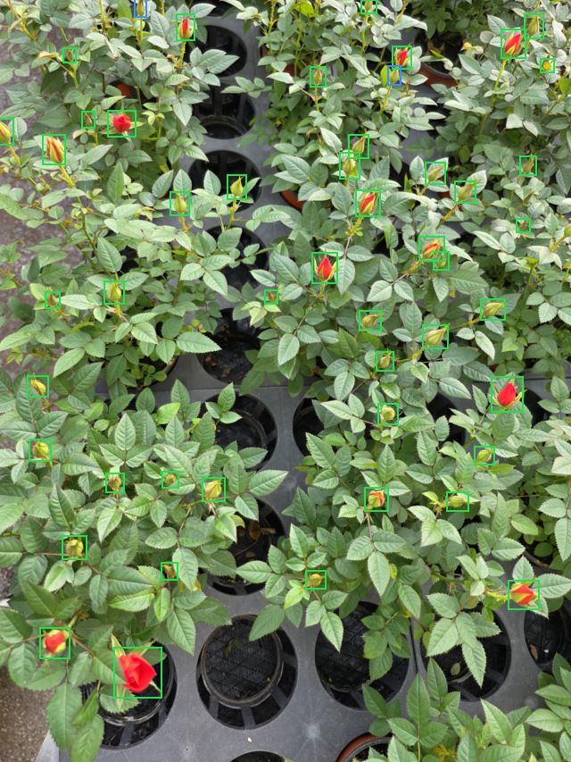
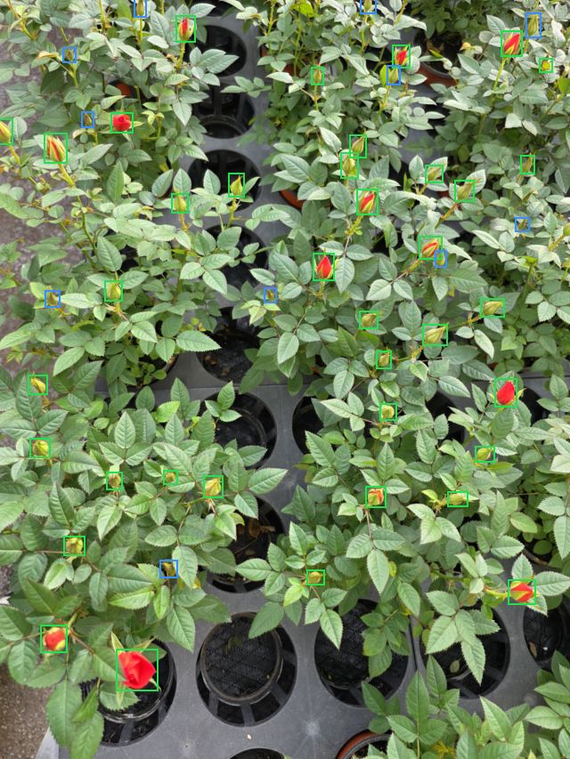
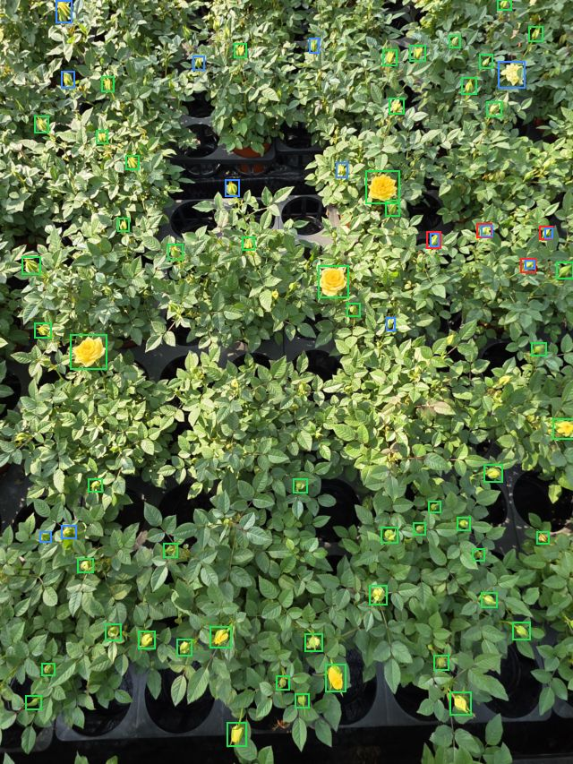
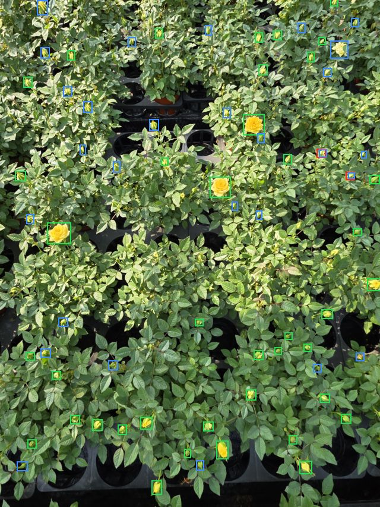
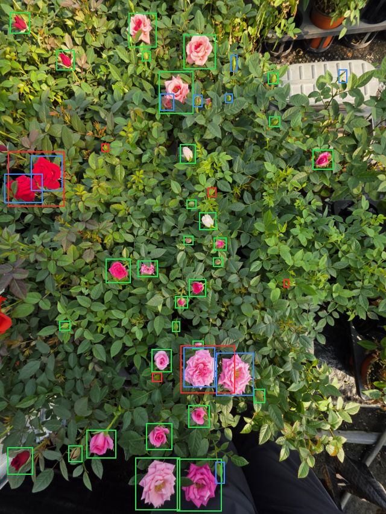
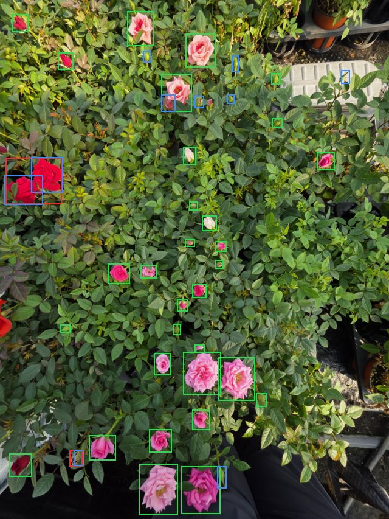
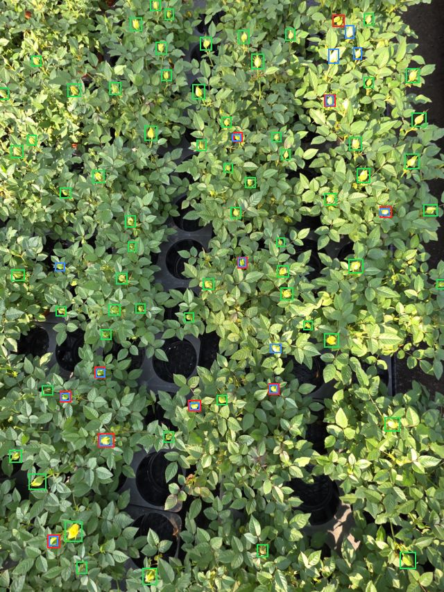
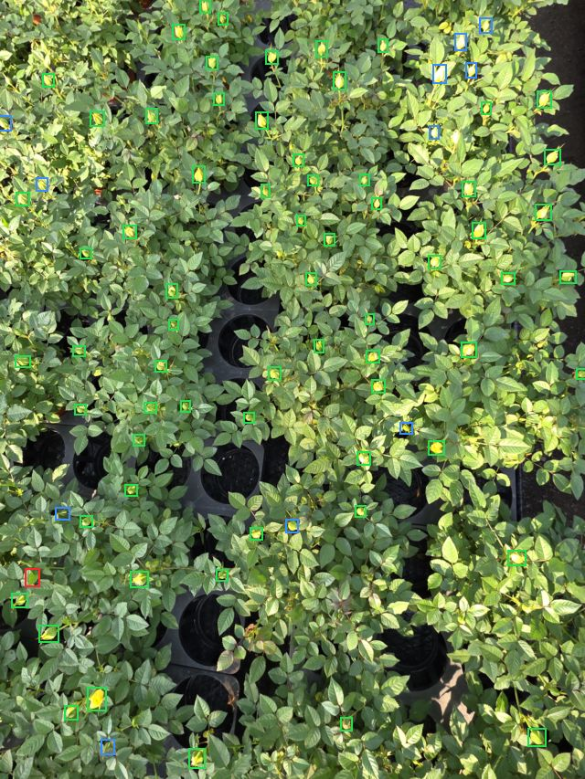

# 꽃 모델 v1, v2 비교

> 그림을 포함한 페이지: [COMPARE.html](COMPARE.html)

## 요약
- **확실한 차이는 test의 세 가지입니다.** v2는 정밀도가 높고, v1은 IoU 0.3 F1과 사진당 봉오리 개수가 낫습니다.
- **IoU 0.5 F1은 차이가 확실하지 않습니다.** v1 0.894, v2 0.882이고, 구간이 0을 포함합니다.
- **val에서는 거의 같습니다.** F1이 v1 0.928, v2 0.928이고, 봉오리 개수 오차도 1.88, 1.88입니다.
- **v2의 약점은 작은 봉오리이고 강점은 큰 꽃입니다.** 긴 변 80px 미만 재현율은 v1 0.835, v2 0.720이고, 160px 이상은 0.839, 0.911입니다.
- **최종 모델은 아직 정하지 않았습니다.**

## test 비교
| 항목 | v1 | v2 | v1-v2 95% 구간 | 판단 |
|---|---:|---:|---:|---|
| 정밀도 | 0.926 | 0.974 | -0.075 ~ -0.013 | **v2 우세** |
| 재현율 | 0.864 | 0.806 | -0.006 ~ 0.115 | 확실하지 않음 |
| F1 (IoU 0.5) | 0.894 | 0.882 | -0.032 ~ 0.056 | 확실하지 않음 |
| F1 (IoU 0.3) | 0.939 | 0.892 | 0.007 ~ 0.081 | **v1 우세** |
| F1 (IoU 0.5, 추가 라벨 제외) | 0.887 | 0.897 | -0.060 ~ 0.029 | 확실하지 않음 |
| F1 (IoU 0.3, 추가 라벨 제외) | 0.936 | 0.908 | -0.007 ~ 0.058 | 확실하지 않음 |
| 사진당 봉오리 개수 오차 | 2.41 | 6.06 | -6.412 ~ -1.294 | **v1 우세** |
| 사진당 개화중 개수 오차 | 0.71 | 0.76 | -0.294 ~ 0.118 | 확실하지 않음 |
| 사진당 만개 개수 오차 | 0.53 | 0.53 | -0.235 ~ 0.235 | 확실하지 않음 |
| 매크로 F1 (단계까지) | 0.751 | 0.764 | v1 0.681~0.815, v2 0.672~0.823 | 구간이 겹침 |
| 봉오리 수 (라벨 475) | 436 | 374 | - | v1이 라벨에 가까움 |
| 오탐 / 놓침 | 38 / 75 | 12 / 107 | - | v2는 오탐이 적고 v1은 놓침이 적음 |

사진당 봉오리 개수는 v1이 9장, v2가 2장에서 라벨에 더 가깝고, 6장은 같습니다.

- **같은 조건:** 같은 test, val 사진과 같은 라벨로 평가했고, 임계값은 val F1로 정한 0.65로 두 모델이 같습니다. IoU 0.5 이상이면 맞은 것으로 칩니다.
- **구간:** test 17장을 복원 추출해 4,000번 계산한 v1-v2 차이의 95% 구간입니다. 0을 포함하면 우연일 수 있어 "확실하지 않음"으로 적었습니다. 사진 수가 적어 대략적인 값입니다.
- **추가 라벨 제외:** 판정으로 추가한 봉오리 44개 중 43개의 박스가 v1 예측이라, 넣으면 v1에 유리합니다. 다만 사람이 확인한 진짜 봉오리라 빼면 v2에 유리합니다. 실제는 그 사이로 봅니다.
- **값의 출처:** 표의 값은 평가 결과 파일에서 읽었고, "추가 라벨 제외"와 구간은 저장된 예측으로 다시 계산했습니다. 반올림 때문에 v1 오탐이 1개 다를 수 있습니다.

## val 비교
| 항목 | v1 | v2 |
|---|---:|---:|
| 정밀도 | 0.928 | 0.931 |
| 재현율 | 0.928 | 0.925 |
| F1 (IoU 0.5) | 0.928 | 0.928 |
| F1 (IoU 0.3) | 0.952 | 0.945 |
| 매크로 F1 | 0.684 | 0.674 |
| 사진당 봉오리 개수 오차 | 1.88 | 1.88 |

## 어디서 차이가 나는가
| 구분 | 라벨 수 | v1 재현율 | v2 재현율 | 차이 |
|---|---:|---:|---:|---:|
| 긴 변 80px 미만 | 236 | 0.835 | 0.720 | +0.114 |
| 80~160px | 260 | 0.896 | 0.862 | +0.035 |
| 160px 이상 | 56 | 0.839 | 0.911 | -0.071 |
| 봉오리 | 475 | 0.861 | 0.790 | +0.072 |
| 개화중 | 33 | 0.970 | 0.939 | +0.030 |
| 만개 | 44 | 0.818 | 0.886 | -0.068 |
| 빨간 꽃 구간 | 208 | 0.904 | 0.793 | +0.111 |
| 노란 꽃 구간 | 229 | 0.834 | 0.773 | +0.061 |
| 혼합 구간 | 115 | 0.852 | 0.896 | -0.044 |
| S25 Ultra | 478 | 0.858 | 0.780 | +0.077 |
| S24 FE | 74 | 0.905 | 0.973 | -0.068 |

| 단계 | v1 재현율 | v2 재현율 | v1 정밀도 | v2 정밀도 |
|---|---:|---:|---:|---:|
| 봉오리 | 0.834 | 0.762 | 0.908 | 0.968 |
| 개화중 | 0.667 | 0.727 | 0.564 | 0.571 |
| 만개 | 0.727 | 0.773 | 0.821 | 0.829 |

| 놓침 비교 | 개수 |
|---|---:|
| 둘 다 놓침 | 50 |
| v1만 놓침 | 25 |
| v2만 놓침 | 57 |
| 그중 판정으로 추가한 봉오리 | 22 |
| 그중 칸 판정을 받지 않은 라벨 | 35 |

## 구조와 속도
| 항목 | v1 | v2 |
|---|---|---|
| 구조 | YOLO26s 박스 탐지 + 박스별 분류 | YOLO26s-seg + ID + ID별 분류 |
| 꽃마다 마스크 | 없음 | 있음 |
| ID 부여 | 아직 없음 (붙일 수 있음) | 구현됨 |
| 단계 분류기 | `cls/effnetv2s_r2` | 같음 |
| 가중치 파일 | 20.3MB | 23.4MB |
| 파라미터 (추론 기준) | 947만 | 1,037만 |
| 모델 추론 (사진 1장, 화면 13개, V100) | 0.071초 | 0.094초 |

## 사진별 비교 (test)
| 사진 | 구간 | 라벨 | v1 찾음 | v2 찾음 | v1 오탐 | v2 오탐 | v1 놓침 | v2 놓침 | 봉오리 라벨 | v1 봉오리 | v2 봉오리 |
|---|---|---:|---:|---:|---:|---:|---:|---:|---:|---:|---:|
| `134905` | mixed | 41 | 31 | 31 | 6 | 2 | 10 | 10 | 19 | 18 | 11 |
| `134908` | mixed | 19 | 15 | 18 | 4 | 3 | 4 | 1 | 13 | 14 | 14 |
| `134920` | mixed | 25 | 23 | 24 | 0 | 1 | 2 | 1 | 11 | 8 | 9 |
| `134924` | mixed | 14 | 14 | 14 | 0 | 0 | 0 | 0 | 11 | 10 | 10 |
| `134937` | mixed | 16 | 15 | 16 | 1 | 1 | 1 | 0 | 8 | 6 | 7 |
| `135007` | yellow | 48 | 44 | 43 | 3 | 0 | 4 | 5 | 45 | 43 | 41 |
| `135030` | yellow | 2 | 0 | 0 | 0 | 0 | 2 | 2 | 1 | 0 | 0 |
| `135036` | yellow | 3 | 2 | 2 | 0 | 0 | 1 | 1 | 2 | 1 | 1 |
| `135041` | yellow | 30 | 28 | 25 | 0 | 0 | 2 | 5 | 23 | 23 | 19 |
| `135048` | yellow | 68 | 54 | 40 | 4 | 2 | 14 | 28 | 63 | 52 | 36 |
| `135052` | yellow | 78 | 63 | 67 | 12 | 1 | 15 | 11 | 77 | 72 | 65 |
| `140419` | red | 38 | 37 | 36 | 1 | 0 | 1 | 2 | 37 | 36 | 35 |
| `140426` | red | 42 | 40 | 38 | 1 | 1 | 2 | 4 | 40 | 39 | 37 |
| `140433` | red | 49 | 47 | 38 | 0 | 0 | 2 | 11 | 47 | 45 | 36 |
| `140440` | red | 79 | 64 | 53 | 6 | 1 | 15 | 26 | 78 | 69 | 53 |

## 같은 사진으로 보기
초록 맞게 찾음, 빨강 오탐, 파랑 놓침

## 한계
- **v2만 놓친 57개 중 35개는 칸 판정을 받지 않았습니다.** test 사진 검수는 거쳤지만 잎이 섞여 있으면 v2의 재현율과 봉오리 개수 오차가 실제보다 나쁘게 나옵니다.
- **test 17장, val 8장 모두 휴대폰 사진입니다.** 큐브의 ESP32 카메라에서는 꽃 크기와 화질이 달라 이 비교가 바뀔 수 있습니다.
- **학습은 각 모델 한 번뿐입니다.** 씨앗을 바꾼 반복 학습이 없어 작은 차이는 우연일 수 있습니다.
- **마스크 정확도는 평가하지 못했습니다.** 사람이 그린 마스크 정답이 없어, 이 페이지의 비교는 모두 박스 기준입니다.
- **Jetson 추론 시간은 재지 않았습니다.** 표의 시간은 V100에서 잰 모델 추론만이고, 사진 열기, 화면 준비, 결과 합치기는 뺐습니다.

## 선택지
| 방향 | 장점 | 단점 |
|---|---|---|
| **v2 유지, 재현율 개선** (Claude의 추천) | 요청한 세그멘테이션과 ID 구조 그대로이고 꽃마다 마스크가 있음 | 재학습이 필요하고 나아진다는 보장이 없음 |
| **v1 사용, 박스에 ID 부여** | 지금 바로 봉오리를 더 잘 셈 | 마스크가 없음. 단계 분류는 지금도 마스크를 쓰지 않으므로, 쓸 계획이 없다면 현실적인 선택 |

결정은 사용자가 합니다.
