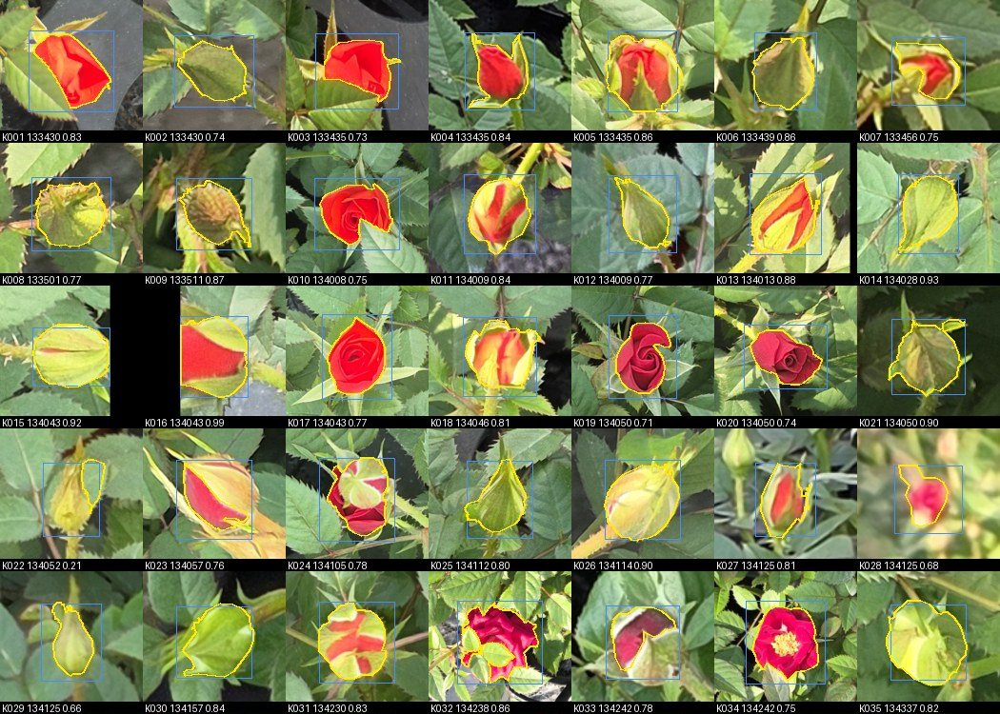
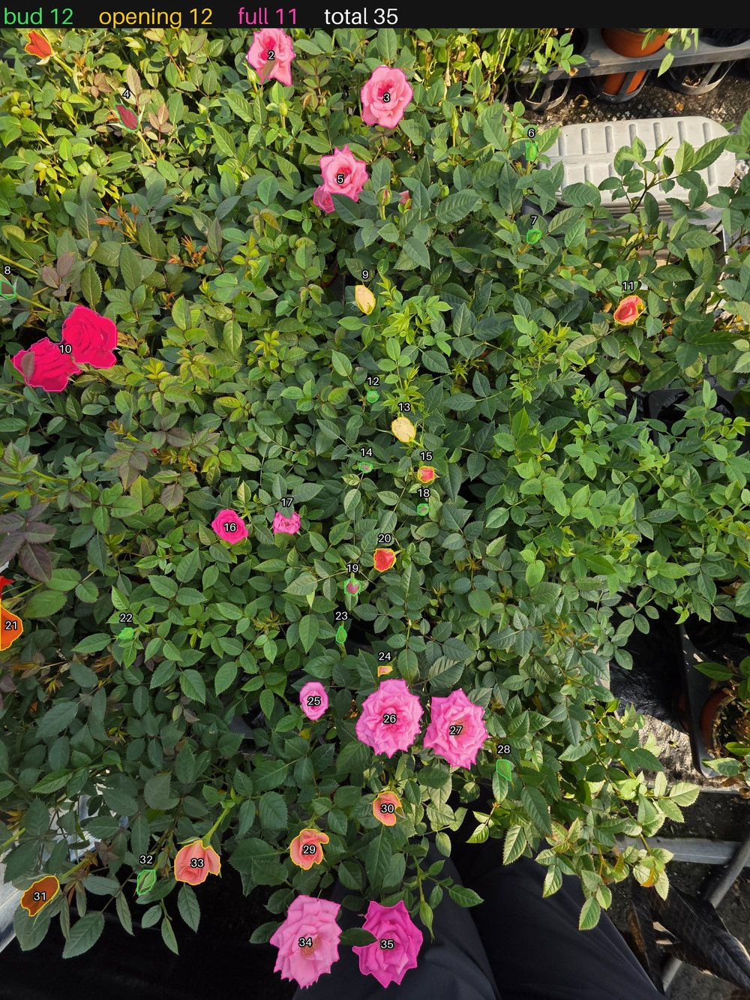
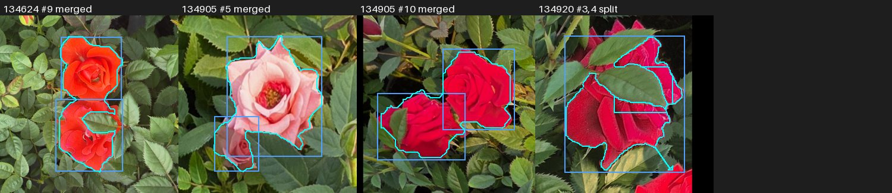
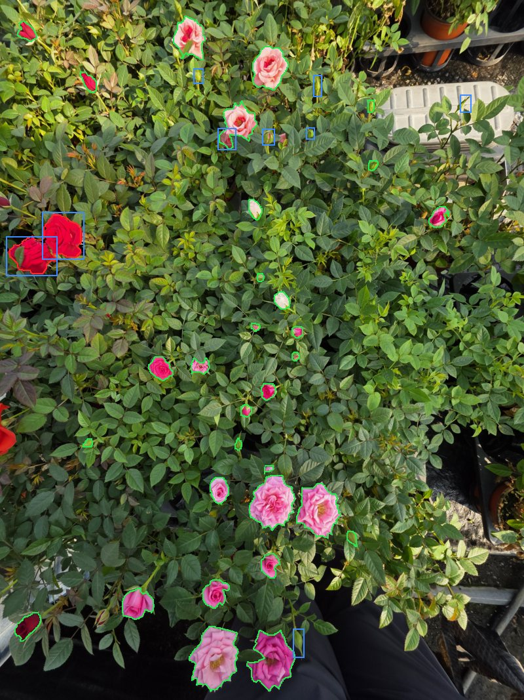

# 꽃 모델 v2 리포트: 마스크 라벨, 세그멘테이션, ID 부여

> 그림을 포함한 리포트: [REPORT.html](REPORT.html) (비교 기준: [v1_box](../v1_box/REPORT.md))

| 항목 | 내용 |
|---|---|
| 유형 | 데이터 + 모델 |
| 작업일 | 2026-11-03 ~ 04 |
| 비교 기준 | v1_box `det/third_pseudo` + `cls/effnetv2s_r2` |
| 모델 | `runs/seg/first` (YOLO26s-seg, `flower` 1클래스, 80회) |
| 상태 | **세그멘테이션 학습, 비교, ID 부여 완료. 최종 확정 전** |

## 요약
- 박스 라벨과 임시 라벨 5,449개로 SAM2.1 마스크 초안을 만들어 세그멘테이션 모델을 학습했고, 찾은 꽃마다 ID를 붙여 단계를 분류합니다.
- 사용자가 v1의 오류 시트 167칸을 판정해 test 라벨을 고쳤습니다. 지금 test F1은 v1 0.894, v2 0.877이고, 정밀도는 0.924, 0.961, 재현율은 0.866, 0.806입니다.
- v2는 오탐이 적고 큰 꽃을 더 찾지만 봉오리를 더 놓칩니다. 사진당 봉오리 개수 오차는 v1 2.29, v2 5.76입니다.
- **아직 어느 쪽이 낫다고 확정할 수 없습니다.** 판정이 v1의 오류만 대상으로 해서 v1에 유리합니다. 추가 라벨을 빼면 IoU 0.5에서 v2가 조금 높고, IoU 0.3과 봉오리 개수에서는 v1이 앞섭니다.
- **ID 부여를 붙였습니다.** val, test 25장의 꽃 774개에 번호를 매겼고, 박스와 단계는 기존 평가와 같습니다. 번호는 사진 한 장 안에서만 유효합니다.

## 마스크 라벨 만들기
- **대상:** 사진 133장의 모든 꽃. 봉오리, 개화중, 만개를 구분하지 않고 만듭니다.
- **창:** 박스 긴 변의 0.75배 + 16px 여백으로 잘라 SAM에 넣습니다. 사진 전체를 넣으면 작은 봉오리가 뭉개지기 때문입니다.
- **후처리:** 조각이 여러 개면 가장 큰 덩어리만 남기고 다각형으로 저장합니다 (허용 오차 1px).
- **임시 라벨:** v1 `det/second`의 신뢰도 0.7 이상 예측 중 기존 라벨, 제외 영역, 차단 목록과 겹치지 않는 3,280개입니다. 판정을 마친 표본 100개는 라벨 또는 제외 영역으로 옮겼습니다.
- **저장:** `labels/masks.jsonl`에 사진, 라벨 번호, 단계, 박스, 다각형, 품질 지표를 기록합니다. 중복 라벨과 2차 판정으로 지운 라벨의 마스크 16개를 빼 지금은 5,433개입니다.

## 마스크 품질 (생성 직후)
| 마스크 박스와 프롬프트 박스의 IoU | 개수 | 비율 |
|---|---:|---:|
| IoU 0.7 이상 | 4891 | 89.8% |
| 0.5~0.7 | 448 | 8.2% |
| 0.3~0.5 | 37 | 0.7% |
| 0.3 미만 | 55 | 1.0% |
| 마스크 없음 | 18 | 0.3% |

### 단계별
| 구분 | 개수 | IoU 0.7 이상 | 0.5~0.7 | 0.5 미만 + 없음 | 실패 비율 |
|---|---:|---:|---:|---:|---:|
| 봉오리 | 1871 | 1672 | 148 | 51 | 2.7% |
| 개화중 | 161 | 135 | 21 | 5 | 3.1% |
| 만개 | 137 | 126 | 6 | 5 | 3.6% |
| 임시 라벨 | 3280 | 2958 | 273 | 49 | 1.5% |

### 크기별
| 구분 | 개수 | IoU 0.7 이상 | 0.5~0.7 | 0.5 미만 + 없음 | 실패 비율 |
|---|---:|---:|---:|---:|---:|
| 40px 미만 | 219 | 189 | 26 | 4 | 1.8% |
| 40~80px | 2643 | 2335 | 234 | 74 | 2.8% |
| 80~160px | 2341 | 2140 | 174 | 27 | 1.2% |
| 160px 이상 | 246 | 227 | 14 | 5 | 2.0% |

### 분할별
| 구분 | 개수 | IoU 0.7 이상 | 0.5~0.7 | 0.5 미만 + 없음 | 실패 비율 |
|---|---:|---:|---:|---:|---:|
| train | 4637 | 4132 | 413 | 92 | 2.0% |
| val | 293 | 266 | 18 | 9 | 3.1% |
| test | 519 | 493 | 17 | 9 | 1.7% |

### 출처별
| 구분 | 개수 | IoU 0.7 이상 | 0.5~0.7 | 0.5 미만 + 없음 | 실패 비율 |
|---|---:|---:|---:|---:|---:|
| draft | 1088 | 1021 | 40 | 27 | 2.5% |
| legacy | 879 | 732 | 119 | 28 | 3.2% |
| review | 202 | 180 | 16 | 6 | 3.0% |
| pseudo | 3280 | 2958 | 273 | 49 | 1.5% |

### 재생성
- IoU 0.5 미만이거나 마스크가 없는 110개는 창 크기와 프롬프트 박스 크기를 바꿔 다시 만들었습니다. **101개를 고쳤고 9개는 학습에서 회색으로 가렸습니다.**
- 기준을 넘겼어도 재생성 마스크의 일부는 옆 꽃이나 잎으로 번진 것처럼 보입니다. 전체의 2% 미만이라 그대로 두었습니다.
- 0.5~0.7 구간은 대부분 쓸 만해 보여 그대로 썼고, 꽃받침이 빠진 마스크도 일괄 수정하지 않았습니다.

## 마스크 시트를 본 인상
Claude가 썸네일로 본 인상입니다. 사람 판정이 아닙니다.

- **대부분 윤곽을 잘 따라갑니다.** 봉오리, 만개, 초록 봉오리 모두 그렇습니다.
- **색 있는 꽃잎만 잡는 경우가 있습니다.** `K001`, `K003`, `X045`, `X048`처럼 초록 꽃받침이 빠집니다. 꽃받침을 포함하는 박스 라벨 규칙과 다릅니다.
- **거의 실패한 마스크가 있었습니다.** `K022`, `K056`, `X021`, `X035`는 일부만 잡았고, `K046`, `K087`, `X032`, `X068`은 비어 있거나 거의 비어 있었습니다 (재생성 전).
- **지표가 나빠도 멀쩡한 것이 많습니다.** 품질 지표에 걸린 573개 중 표본 70개를 보면 상당수는 쓸 만해 보였습니다.

## 라벨링: Claude 검수 후 사람 판정
- **과정:** Claude가 초안을 만들고, 모델이 틀린 곳을 번호 칸으로 잘라 Claude가 먼저 확인한 뒤, **사용자가 칸마다 판정합니다.** Claude의 인상으로는 라벨을 바꾸지 않습니다.
- **사용자가 판정한 칸:** 지금까지 737개입니다. test 17장은 사진 단위 검수도 했습니다. 회차별 내역과 칸별 판정은 [v1 리포트](../v1_box/REPORT.md)의 라벨링 절에 있습니다.
- **v2에 해당하는 부분:** 박스 라벨은 v1과 같은 원본을 씁니다. **SAM 마스크는 사람 판정이 없고**, v2의 오탐 칸도 아직 판정 전입니다.
- **최신 판정으로 추가한 라벨 43개는 마스크가 없습니다.** test 라벨이라 학습에는 쓰지 않습니다.

## 세그멘테이션 학습
- **구조:** YOLO26s-seg, 파라미터 약 1,037만 개, COCO 사전학습 `yolo26s-seg.pt`에서 시작했습니다.
- **v1과 같은 조건:** 사진, 타일과 축척, 증강, 회차(80회), 임시 라벨 출처가 `third_pseudo`와 같습니다. 라벨이 박스에서 다각형으로 바뀌었고, 표본 판정 100개가 반영된 점만 다릅니다.
- **학습 데이터:** train 타일 1,404장, 대상 12,394개. V100에서 약 30분 걸렸습니다.
- **타일 기준 val (SAM 초안 라벨, 임계값 없음):** mAP50 박스 0.949, 마스크 0.893. 사진 단위 점수와 다른 값입니다.

## v1과 탐지 비교
| 항목 | v1 `third_pseudo` | v2 `seg/first` |
|---|---:|---:|
| 임계값 (val F1 기준) | 0.65 | 0.65 |
| val F1 | 0.928 | 0.928 |
| test 정밀도 | 0.924 | 0.961 |
| test 재현율 | 0.866 | 0.806 |
| test F1 | 0.894 | 0.877 |
| test 오탐 | 39 | 18 |
| test 놓침 | 74 | 107 |
| test F1 (IoU 0.3) | 0.939 | 0.887 |

### 라벨 정리에 따른 변화
**중복 정리:** 한 봉오리에 박스가 2개 있던 10쌍에서 1개씩 지웠습니다. 모두 Claude의 초안에서 생겼습니다. **판정 반영:** v1 `third_pseudo`의 오류 시트(오탐 86칸, 미탐 81칸)를 사용자가 판정한 결과입니다. 두 경우 모두 모델의 예측과 임계값은 그대로이고 라벨만 바뀌었습니다.

| test 항목 | v1 처음 | v1 중복 정리 | v1 판정 반영 | v2 처음 | v2 중복 정리 | v2 판정 반영 |
|---|---:|---:|---:|---:|---:|---:|
| 라벨 수 | 519 | 515 | 551 | 519 | 515 | 551 |
| 오탐 | 87 | 87 | 39 | 41 | 41 | 18 |
| 놓침 | 85 | 81 | 74 | 95 | 91 | 107 |
| 정밀도 | 0.833 | 0.833 | 0.924 | 0.912 | 0.912 | 0.961 |
| 재현율 | 0.836 | 0.843 | 0.866 | 0.817 | 0.823 | 0.806 |
| F1 (IoU 0.5) | 0.835 | 0.838 | 0.894 | 0.862 | 0.865 | 0.877 |
| F1 (IoU 0.3) | 0.885 | 0.888 | 0.939 | 0.874 | 0.878 | 0.887 |
| 매크로 F1 | 0.722 | 0.723 | 0.751 | 0.753 | 0.755 | 0.760 |
| 사진당 봉오리 개수 오차 | 2.94 | 2.94 | 2.29 | 5.29 | 5.06 | 5.76 |

### 판정 편향 확인
| 기준 | v1 정밀도 | v1 재현율 | v1 F1 | v2 정밀도 | v2 재현율 | v2 F1 |
|---|---:|---:|---:|---:|---:|---:|
| 모든 라벨, IoU 0.5 | 0.926 | 0.866 | 0.895 | 0.961 | 0.806 | 0.877 |
| 추가 라벨 제외, IoU 0.5 | 0.920 | 0.854 | 0.886 | 0.959 | 0.833 | 0.892 |
| 모든 라벨, IoU 0.3 | 0.973 | 0.909 | 0.940 | 0.972 | 0.815 | 0.887 |
| 추가 라벨 제외, IoU 0.3 | 0.970 | 0.902 | 0.935 | 0.971 | 0.843 | 0.902 |

- **이번 판정은 v1에 유리합니다.** 추가한 봉오리 43개의 박스가 v1의 예측이라 v1은 전부 정답이 되고, v2의 오탐 18칸은 아직 판정하지 않았습니다.
- **추가 라벨을 빼면 IoU 0.5의 순서가 바뀝니다.** 모든 라벨로는 v1이, 추가 라벨을 뺀 평가로는 v2가 조금 높습니다. IoU 0.3에서는 어느 쪽이든 v1이 높습니다.
- **추가한 봉오리는 사람이 확인한 실제 봉오리입니다.** v2는 임계값 0.65에서 43개 중 21개를 찾았고, 임계값을 0.3으로 낮추면 37개를 찾습니다. 놓친 원인의 상당수가 낮은 신뢰도라는 뜻입니다.
- 이 표의 값은 저장된 예측으로 다시 계산해, 위 표와 오탐이 1개 다를 수 있습니다.

### 구분별 재현율
| 구분 | 라벨 수 | v1 재현율 | v2 재현율 |
|---|---:|---:|---:|
| <80px | 235 | 0.838 | 0.719 |
| 80-160px | 260 | 0.896 | 0.862 |
| >=160px | 56 | 0.839 | 0.911 |
| 봉오리 | 474 | 0.863 | 0.789 |
| 개화중 | 33 | 0.970 | 0.939 |
| 만개 | 44 | 0.818 | 0.886 |
| test_red | 208 | 0.904 | 0.793 |
| test_yellow | 228 | 0.838 | 0.772 |
| test_mixed | 115 | 0.852 | 0.896 |
| S25U | 477 | 0.860 | 0.780 |
| S24FE | 74 | 0.905 | 0.973 |

- **v2의 낮은 임계값:** 임계값 0.55는 정밀도 0.907, 재현율 0.848입니다. test를 보고 고른 참고값이라 후보 선정에는 쓰지 않습니다.
- **마스크를 감싼 박스:** test F1이 0.856로 모델 박스의 0.877보다 낮습니다. 마스크에서 꽃받침이 빠지는 것이 원인일 수 있지만 확인하지 않았습니다. 그래서 분류 입력과 박스 평가에는 모델 박스를 씁니다.
- **놓침 비교:** 둘 다 놓침 50개, v1만 놓침 24개, v2만 놓침 57개입니다. v2만 놓친 57개 중 56개가 봉오리입니다.

### 사진별
저장된 예측값의 반올림 때문에 v1 오탐 합계가 위 표보다 1개 적습니다.

| 사진 | 라벨 | v1 찾음 | v2 찾음 | v1 오탐 | v2 오탐 | v1 놓침 | v2 놓침 |
|---|---:|---:|---:|---:|---:|---:|---:|
| `134905` | 41 | 31 | 31 | 6 | 2 | 10 | 10 |
| `134908` | 19 | 15 | 18 | 4 | 3 | 4 | 1 |
| `134920` | 25 | 23 | 24 | 0 | 2 | 2 | 1 |
| `134924` | 14 | 14 | 14 | 0 | 0 | 0 | 0 |
| `134937` | 16 | 15 | 16 | 1 | 1 | 1 | 0 |
| `135007` | 48 | 44 | 43 | 3 | 1 | 4 | 5 |
| `135030` | 2 | 0 | 0 | 0 | 0 | 2 | 2 |
| `135036` | 3 | 2 | 2 | 0 | 2 | 1 | 1 |
| `135041` | 30 | 28 | 25 | 0 | 0 | 2 | 5 |
| `135048` | 68 | 54 | 40 | 4 | 2 | 14 | 28 |
| `135052` | 77 | 63 | 66 | 11 | 2 | 14 | 11 |
| `140419` | 38 | 37 | 36 | 1 | 0 | 1 | 2 |
| `140426` | 42 | 40 | 38 | 2 | 2 | 2 | 4 |
| `140433` | 49 | 47 | 38 | 0 | 0 | 2 | 11 |
| `140440` | 79 | 64 | 53 | 6 | 1 | 15 | 26 |

## 탐지와 분류 연결
| 항목 | v1 | v2 |
|---|---:|---:|
| test 매크로 F1 | 0.751 | 0.760 |
| test 95% 구간 | 0.681~0.814 | 0.668~0.817 |
| val 매크로 F1 | 0.684 | 0.674 |
| test 봉오리 수 (라벨 474) | 437 | 378 |
| test 사진당 개수 오차 (봉오리 / 개화중 / 만개) | 2.29 / 0.71 / 0.53 | 5.76 / 0.82 / 0.53 |

| 단계 | v1 재현율 | v2 재현율 | v1 정밀도 | v2 정밀도 |
|---|---:|---:|---:|---:|
| 봉오리 | 0.835 | 0.762 | 0.906 | 0.955 |
| 개화중 | 0.667 | 0.727 | 0.564 | 0.558 |
| 만개 | 0.727 | 0.773 | 0.821 | 0.829 |

### v2 test 혼동 행렬
| 라벨 \ 예측 | 봉오리 | 개화중 | 만개 | 없음 (놓침) |
|---|---:|---:|---:|---:|
| 봉오리 | 361 | 12 | 1 | 100 |
| 개화중 | 3 | 24 | 4 | 2 |
| 만개 | 0 | 5 | 34 | 5 |
| 라벨 없음 (오탐) | 14 | 2 | 2 | 0 |

매크로 F1 차이는 구간 안이어서 의미 있는 차이가 아닙니다. 봉오리 개수 오차는 v2가 나쁘고, 개화중과 만개 오차는 비슷합니다. 분류기는 v1과 같습니다. 이 평가에도 추가 라벨의 영향이 들어 있습니다.

## ID 부여와 ID별 분류
- **순서:** 세그멘테이션으로 꽃을 찾고, 위에서 아래, 왼쪽에서 오른쪽 순서로 번호를 매긴 뒤, 번호별로 단계를 분류합니다. 잎 모델 `v7_leafid`와 같은 규칙입니다.
- **번호 형식:** `<사진>_F0001`. **사진 한 장 안에서만 유효**하며, 다른 사진의 같은 꽃과 이어지지 않습니다.
- **분류 입력:** 모델 박스의 긴 변 × 1.25 정사각형 크롭입니다. 마스크는 분류에 쓰지 않고, ID별 영역 정보로 남깁니다.
- **출력:** `<사진>_ids.jpg`, `<사진>_sheet.jpg`, `flowers.csv`, `flowers.json`, `summary.csv`입니다.
- **단계별 개수:** 봉오리 642, 개화중 71, 만개 61입니다.

| 분할 | 사진 | 꽃 |
|---|---:|---:|
| val | 8 | 295 |
| test | 17 | 479 |
| 합계 | 25 | 774 |

### 기존 평가와 일치 확인
| 확인 항목 | 결과 |
|---|---|
| val 혼동 행렬과 기존 평가 | 일치 |
| test 혼동 행렬과 기존 평가 | 일치 |
| 사진별 단계 개수와 기존 평가 | 일치 |
| 박스, 다각형, 번호 (빠짐과 중복 포함) | 일치 |
| 넓이가 0인 마스크 | 0개 |
| 마스크가 겹치는 ID 쌍 | 5쌍 (절반 이상 겹침 0쌍) |

ID를 붙이면서 꽃이나 단계가 바뀌지 않았으므로 **성능은 7절의 값 그대로입니다.** 추론 코드를 `infer.py`로 옮긴 뒤 평가를 다시 돌려 val, test 예측이 이전과 같은 것도 확인했습니다.

### ID 하나가 꽃 하나인가
- **합쳐짐 3개:** 한 마스크 안에 라벨 중심이 2개 이상 들어간 ID입니다. 그림으로 봐도 꽃 두 송이가 합쳐져 있습니다 (`134624` 9번, `134905` 5번, `134905` 10번). 중복 라벨 정리 전에는 8개였고, 5개가 중복 라벨 때문이었습니다.
- **쪼개짐 의심 1건:** 한 라벨 박스 안에 ID가 2개 이상 들어간 경우입니다. `134920` 3번과 4번으로, 한 송이가 잎에 가려 둘로 나뉜 것으로 보입니다 (Claude의 인상).
- 전체 774개에 비하면 적지만 **하한으로 봐야 합니다.** 라벨 중심이 마스크 밖이면 합쳐짐으로 세지 않고, 라벨이 없는 꽃은 셀 수 없습니다. 놓친 꽃에는 애초에 ID가 없습니다.
- **볼록도는 합쳐짐 기준이 되지 못합니다.** 잎 모델처럼 0.8 미만을 찾으면 14개인데, 그림으로 보면 대부분 잎에 가려진 한 송이입니다 (Claude의 인상).

### 단계 확률
| 예측 단계 | 단계가 맞은 꽃 | 확률 중앙값 | 단계가 틀린 꽃 | 확률 중앙값  |
|---|---:|---:|---:|---:|
| 봉오리 | 583 | 0.525 | 10 | 0.526 |
| 개화중 | 34 | 0.930 | 29 | 0.655 |
| 만개 | 49 | 0.978 | 9 | 0.905 |

**봉오리의 단계 확률은 신뢰도로 쓸 수 없습니다.** 맞은 경우와 틀린 경우의 값이 거의 같습니다. 분류 학습의 클래스 가중치와 라벨 스무딩(0.1) 영향으로 추정하지만 확인하지 않았습니다. 개화중은 차이가 있지만 틀린 예측도 높은 값이 많습니다. 라벨과 IoU 0.5 이상으로 맞은 꽃만 셌고, val과 test를 합친 값입니다.

### 처리 시간
**처리 시간 (V100):** 탐지는 사진당 중앙값 0.43초, 분류는 꽃 하나당 약 34ms입니다. 사진 열기와 그림 저장은 뺐고, 탐지 값에서 모델을 처음 올리는 첫 사진도 뺐습니다. Jetson에서는 재지 않았습니다.

### ESP 카메라 사진
- 폴더 입력 확인을 겸해 잎 평가용 ESP 카메라 사진 6장을 돌렸습니다. 5장은 0개, 1장은 봉오리 1개입니다 (탐지 신뢰도 0.733).
- 그 1개는 확대해도 흐려서 진짜 봉오리인지 알 수 없습니다. 6장을 축소해 보면 큰 꽃은 보이지 않지만, 작은 봉오리는 그 크기로 판단할 수 없습니다.
- **꽃이 찍힌 사진이 아니라서 이 카메라의 꽃 탐지 성능은 아직 알 수 없습니다.** 라벨도 없습니다.

## v1 평가에서 본 문제의 변화
- **큰 꽃 놓침, 일부 해결:** `M008`, `M009`, `M018`을 이제 찾습니다. 긴 변 1,830px인 `M024`는 여전히 못 찾습니다.
- **붙은 꽃, 일부 해결:** 분홍 꽃 두 송이(`F005`)는 따로 잡히지만, 빨간 꽃 두 송이(`F002`, `M002`, `M003`)는 아직 하나로 묶입니다. 번호는 사용자가 판정한 v1 시트 기준입니다.
- **오탐 집중, 판정으로 해소:** 사진 `135052`의 v1 오탐 35개는 대부분 라벨이 빠진 실제 봉오리였습니다. 지금 오탐은 v1 11개, v2 2개입니다.
- **새로 생긴 약점:** v2는 먼 봉오리가 몰린 곳을 더 놓칩니다. 놓침이 사진 `140440`은 v1 15개, v2 26개이고, `140433`은 2개, 11개입니다.
- **개화중 분류:** 그대로 약합니다. 세그멘테이션으로 해결되는 문제가 아닙니다.

## 한계
- **판정은 v1의 오류만 봤습니다.** 그래서 지금 비교는 v1에 유리합니다. v2의 오탐 칸을 판정해야 공정한 비교가 됩니다.
- **학습은 라벨 정리 전 데이터로 했습니다.** v1, v2 모두 train의 중복 4쌍이 든 채로 학습했고, 재학습하지 않았습니다. test 판정은 학습 데이터에 영향이 없고, 평가만 최신 라벨로 다시 계산했습니다.
- **마스크 라벨은 SAM 초안입니다.** 사람이 그린 정답이 없어 마스크 정확도를 평가하지 못했고, 박스 기준으로만 비교했습니다.
- **품질 지표는 정답과의 비교가 아닙니다.** 프롬프트 박스와 맞는지 보는 값이라, 박스 안에서 일부만 잡아도 박스가 비슷하면 높게 나옵니다.
- **임시 라벨 위의 마스크입니다.** 표본 판정에서 임시 라벨의 약 96%가 꽃이나 봉오리였지만, 나머지 오류는 마스크에도 그대로 남습니다.
- **test는 화분 단위로 분리되지 않았고, 휴대폰 사진 기준입니다.** ESP32 사진 평가가 없습니다.
- **ID는 사진 안에서만 유효합니다.** 같은 꽃을 시간에 따라 따라갈 수 없습니다.
- **Jetson 추론 시간을 재지 않았습니다.** V100 값만 있습니다.
- **학습은 한 번뿐입니다.** 씨앗을 바꾼 반복 학습이 없어 작은 차이는 우연일 수 있습니다.

## 다음 단계
1. v2의 오탐 18칸 판정으로 v1, v2 비교 마무리
2. 봉오리 놓침 원인 확인 (먼 봉오리, 임계값)
3. 개화중 분류 개선
4. 꽃이 찍힌 ESP32 사진으로 독립 평가
5. 같은 꽃을 여러 사진에서 잇는 추적 (시간에 따른 변화를 볼 때 필요)

## 파일
| 경로 | 내용 |
|---|---|
| `labels/masks.jsonl` | 마스크 초안 (재생성 반영) |
| `scripts/10_make_masks.py` | 마스크 생성, 재생성 |
| `scripts/20_export_seg.py` | 학습 데이터 내보내기 |
| `scripts/30_train_seg.py` | 학습 |
| `scripts/31_eval_seg.py` | 사진 단위 평가 |
| `scripts/32_compare_v1.py` | v1 비교 |
| `scripts/13_drop_masks.py` | 중복 라벨의 마스크 제거 |
| `scripts/infer.py` | 탐지와 분류 추론 코드 |
| `scripts/40_flower_ids.py` | ID 부여와 ID별 분류 |
| `scripts/41_check_ids.py` | ID 결과 확인 (`check.json`) |
| `runs/ids/` | ID 결과 (커밋하지 않음) |
| `runs/seg/first/` | 모델과 평가 결과 (커밋하지 않음) |
| `runs/mask_check/` | 확인 시트 원본 (커밋하지 않음) |
| `../v1_box/labels/` | 박스 라벨 원본 |
