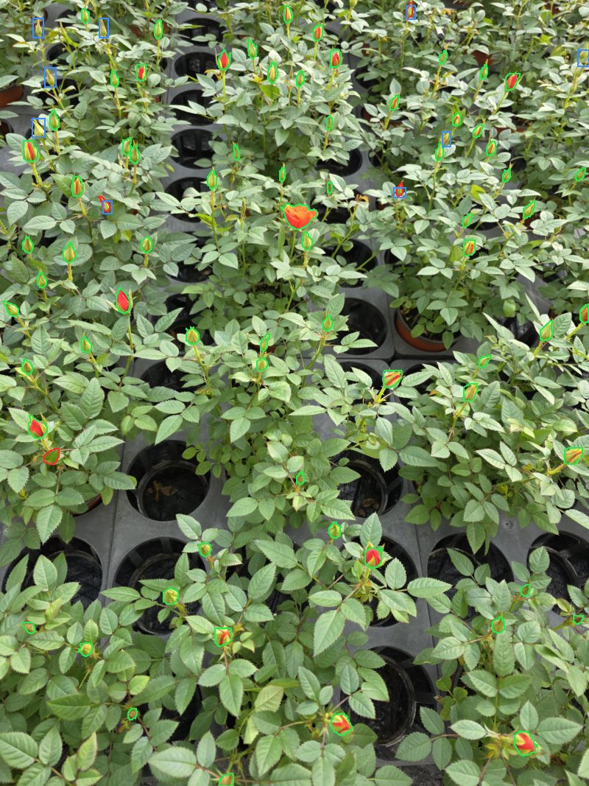
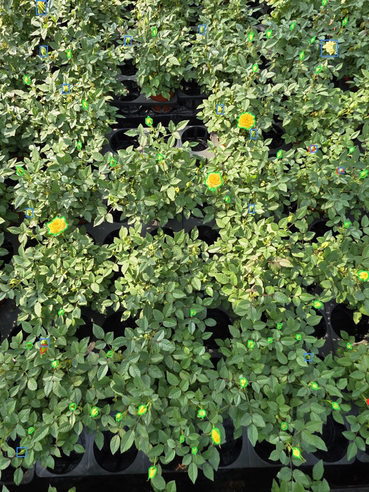
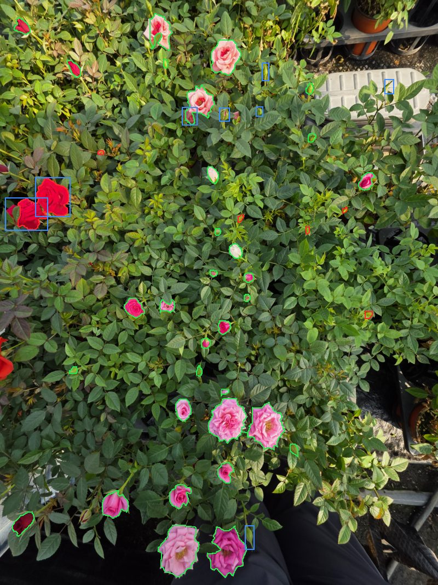
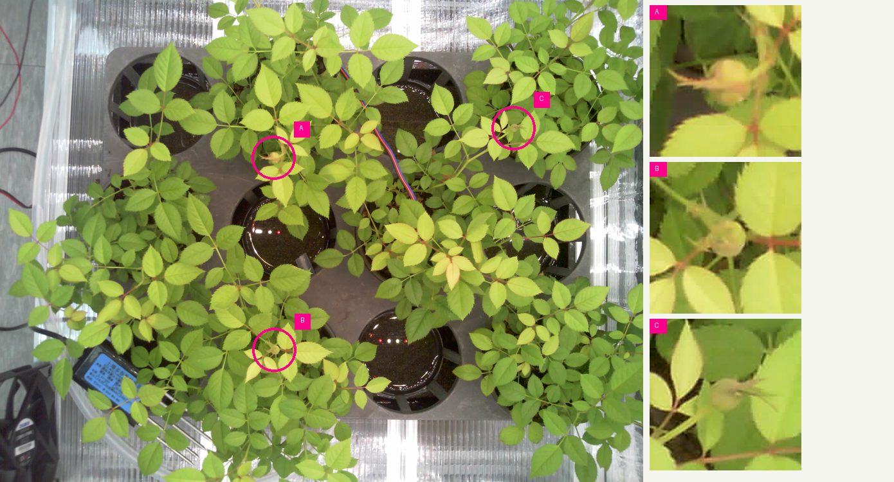

# 꽃 모델 v3 리포트: 팀 교차 판정 라벨

> 그림을 포함한 리포트: [REPORT.html](REPORT.html)

## 요약

- **라벨을 고쳐 재학습했습니다.** 조원 5명의 교차 판정과 사용자 판단으로 train 라벨 1,360개를 추가하고, 구조와 학습 설정은 v2와 같게 두었습니다.
- **test 재현율이 0.809에서 0.913로 올랐습니다.** 긴 변 80px 미만은 0.720에서 0.894이고, 사진당 봉오리 개수 오차는 6.00에서 2.65입니다.
- **오탐이 늘었습니다.** 정밀도는 0.976에서 0.905이고, 오탐은 11개에서 53개입니다. 이 오탐은 사람이 판정하지 않았습니다.
- **라벨 효과라고 단정하지 않습니다.** 조건마다 한 번씩만 학습했고 임계값도 0.65에서 0.60으로 달라졌습니다.
- **ESP 카메라에서는 타일을 880으로 맞췄습니다.** 사진 6장의 봉오리 3개를 16번 중 4번에서 9번 찾게 됐고, 재학습은 하지 않았습니다. 표본이 작아 임시 값입니다.
- **최종 모델은 아직 정하지 않았습니다.**

## 데이터

| 항목 | v2 | v3 |
|---|---:|---:|
| train 라벨 원본 | 1,353 | 2,705 |
| train 전체 (임시 라벨 포함) | 4,633 | 5,980 |
| 사람이 확인한 train | 12.0% | 31.8% |
| 학습 대상 수 (타일 기준) | 12,394 | 15,872 |
| val, test 라벨 | - | v1과 동일 (스크립트로 확인) |

| 새 라벨 크기 | 개수 |
|---|---:|
| <40 | 224 |
| 40-60 | 640 |
| 60-80 | 368 |
| 80-160 | 128 |

- **라벨 사본:** v1_box/labels를 복사해 고쳤습니다. v1_box/labels는 바뀌지 않았습니다.
- **표본 확인 13칸:** 라벨 8개를 지우고, 임시 라벨 5개와 함께 제외 영역이나 차단 목록으로 옮겼습니다.
- **겹침 조정:** 6칸을 뺐습니다 (labels/team_skipped.csv).
- **마스크:** 새 라벨 1,360개를 SAM2.1로 만들었습니다. 박스와의 IoU 0.7 이상 83.2%, 실패 5칸입니다. 사람이 그린 정답이 없어 마스크 정확도는 평가하지 못했습니다.

## 사람 판정

| 판정 | 내용 |
|---|---|
| 후보 | train에서 third_pseudo가 신뢰도 0.5 이상으로 찾았지만 라벨이 없는 1,713칸 |
| 조원 | 칸마다 2명, 10개 짝이 170~172칸씩 겹침. 같은 판정 1,323칸 (77.2%) |
| Claude | 조원 판정을 읽지 않은 별도 에이전트가 판정, 비교 전에 결과 고정 |
| 사용자 | 갈린 390칸, 등급 표본 130칸, 반복 15칸을 판정을 가리고 판단 |

| 등급 | 칸 | 처리 |
|---|---:|---|
| 높음 (사람 2명과 Claude 같음) | 1145 | 판정대로 |
| 보통 (Claude만 다름) | 94 | 판정대로, 표본 확인 |
| 판단 필요 (사람 2명이 다름) | 390 | 사용자 판단 |
| 제외 (둘 다 알수없음) | 84 | 제외 영역 |

- **등급 검증:** 높음 표본에서 봉오리 30칸 중 30칸, 아님 15칸 중 14칸이 사용자와 같습니다. 보통 표본 50칸에서 사용자는 사람과 38칸, Claude와 8칸 같았습니다.
- **기준 칸 103칸:** 조원 80칸, Claude 80칸이 사용자 판정과 같고, 봉오리와 아님의 반대는 조원 4칸, Claude 10칸입니다.
- **처리:** 라벨 추가 1,362, 제외 영역 200, 차단 151칸. 상세 비교는 human_label의 비교 리포트에 있습니다.

## 학습 조건 선택 (val)

| 조건 | 임계값 | 정밀도 | 재현율 | F1 | 오탐/놓침 | 80px 미만 |
|---|---:|---:|---:|---:|---:|---:|
| v2 seg/first | 0.65 | 0.931 | 0.925 | 0.928 | 20/22 | 0.901 |
| A 기준 (라벨만 변경) | 0.6 | 0.926 | 0.949 | 0.937 | 22/15 | 0.931 |
| C mask_ratio 2 | 0.65 | 0.941 | 0.928 | 0.935 | 17/21 | 0.908 |
| B 입력 960 | 0.65 | 0.937 | 0.914 | 0.926 | 18/25 | 0.908 |

목표인 재현율과 F1이 가장 높은 A를 val로 골랐고, test는 A만 한 번 평가했습니다. val에는 노란 꽃 구간이 없고 사진이 8장이라 조건 차이가 우연일 수 있습니다. C와 B의 test는 보지 않았습니다.

## test 비교

| 항목 | v1 | v2 | v3 |
|---|---:|---:|---:|
| 임계값 (val 기준) | 0.65 | 0.65 | 0.6 |
| 정밀도 | 0.926 | 0.976 | 0.905 |
| 재현율 | 0.864 | 0.809 | 0.913 |
| F1 (IoU 0.5) | 0.894 | 0.885 | 0.909 |
| F1 (IoU 0.3) | 0.939 | 0.893 | 0.918 |
| 오탐 / 놓침 | 38 / 75 | 11 / 105 | 53 / 48 |
| 사진당 봉오리 개수 오차 | 2.35 | 6.00 | 2.65 |
| 봉오리 수 (라벨 473) | 435 | 373 | 476 |
| 매크로 F1 (단계까지) | 0.744 | 0.765 | 0.760 |

| v3와의 차이 95% 구간 | v3 - v1 | v3 - v2 |
|---|---:|---:|
| 정밀도 | -0.057 ~ +0.002 | -0.104 ~ -0.039 |
| 재현율 | +0.010 ~ +0.092 | +0.045 ~ +0.145 |
| F1 (IoU 0.5) | -0.017 ~ +0.040 | -0.020 ~ +0.062 |
| F1 (IoU 0.3) | -0.032 ~ +0.006 | -0.011 ~ +0.076 |
| F1 (IoU 0.5, 추가 라벨 제외) | -0.015 ~ +0.045 | -0.038 ~ +0.042 |
| 봉오리 개수 오차 | -0.65 ~ +1.41 | -6.29 ~ -0.94 |

- **확실한 차이:** 재현율은 v1, v2보다 높고, 정밀도는 v2보다 낮으며, 봉오리 개수 오차는 v2보다 낮습니다.
- **확실하지 않은 차이:** F1은 v1, v2와 구간이 0을 포함합니다. 봉오리 개수 오차도 v1과는 구간이 0을 포함합니다.
- **구간:** test 17장을 복원 추출해 4,000번 계산했습니다. 사진 수가 적어 대략적인 값입니다.

| 재현율 | 라벨 | v1 | v2 | v3 |
|---|---:|---:|---:|---:|
| 긴 변 80px 미만 | 236 | 0.835 | 0.720 | 0.894 |
| 80~160px | 258 | 0.895 | 0.868 | 0.930 |
| 160px 이상 | 56 | 0.839 | 0.911 | 0.911 |
| 봉오리 | 473 | 0.861 | 0.793 | 0.909 |
| 개화중 | 33 | 0.970 | 0.939 | 0.970 |
| 만개 | 44 | 0.818 | 0.886 | 0.909 |
| 빨간 꽃 구간 | 208 | 0.904 | 0.793 | 0.942 |
| 노란 꽃 구간 | 228 | 0.833 | 0.776 | 0.899 |
| 혼합 구간 | 114 | 0.851 | 0.904 | 0.886 |

## ESP 카메라 추론

휴대폰 test 점수는 큐브 카메라 성능이 아니라서, 새 ESP 카메라 사진 6장(2560×1920)에 꽃 모델을 돌렸습니다. 같은 트레이를 시점만 바꿔 찍은 사진입니다. 사람이 확인한 봉오리는 3개이고, B는 위치를 믿을 수 있는 4장만 세어 모두 16번입니다. 임계값은 휴대폰 val 값입니다.

| 봉오리 크기 | 휴대폰 | ESP |
|---|---:|---:|
| 사진 | 3000×4000 | 2560×1920 |
| 긴 변 중앙값 | train 68px, test 80px | 약 55px |
| 입력 안 (타일 1280) | 34~40px | 약 27px |

| v3 설정 | 입력 안의 봉오리 | A | B | C | 합계 / 16 | 다른 예측 | 모델 입력 수 |
|---|---:|---:|---:|---:|---:|---:|---:|
| 타일 1280 | 약 28px | 4 | 0 | 0 | 4 | 0 | 7 |
| 타일 1100 | 약 32px | 6 | 0 | 0 | 6 | 0 | 7 |
| 타일 960 | 약 37px | 6 | 2 | 0 | 8 | 0 | 13 |
| 타일 880 | 약 40px | 6 | 3 | 0 | 9 | 1 | 13 |
| 타일 819 | 약 43px | 6 | 2 | 0 | 8 | 2 | 13 |
| 타일 720 | 약 49px | 6 | 3 | 0 | 9 | 5 | 21 |
| 타일 640 | 약 55px | 4 | 3 | 0 | 7 | 7 | 21 |
| 확대 1.56 + 타일 1280 | 약 43px | 6 | 2 | 0 | 8 | 1 | 13 |
| 확대 1.45 + 타일 1280 | 약 40px | 6 | 3 | 0 | 9 | 1 | 13 |

| 조건 (16번 중) | 타일 1280 | 타일 960 |
|---|---:|---:|
| v3 원본 | 4 | 8 |
| v3 + 화이트밸런스 | 3 | 8 |
| 입력 960 모델 B_960 | 2 | 7 |
| B_960 + 화이트밸런스 | 1 | 4 |
| v1 박스 | 4 | 6 |
| v2 세그 | 1 | 3 |

- **축척:** 입력 크기는 학습과 같은 640이고, 봉오리가 입력에서 작아지는 것이 문제였습니다. 재학습 없이 타일만 줄여 v3가 찾은 횟수가 4번에서 9번으로 늘었습니다. 사진을 1.45배 키워도 결과가 같아, 타일을 바꾸는 쪽을 택했습니다.
- **설정:** cameras.json에 카메라별 타일을 두었습니다. phone은 1280, esp는 880이고, 40_flower_ids.py의 --camera로 고릅니다. 휴대폰 설정의 예측은 기존 평가와 같은 것을 사진 1장으로 확인했습니다.
- **타일 880의 다른 예측 1개:** 사진 b676fe의 화분 위 빨간 표시등 반사로 보입니다 (Claude의 인상).
- **화이트밸런스:** 잎 모델의 gray_world는 사진 평균 G를 2~5 낮출 뿐 효과가 없어 넣지 않았습니다. 다른 LED 상태는 시험하지 못했습니다.
- **봉오리 C:** 어떤 조건에서도 찾지 못했습니다 (신뢰도 최고 0.32). ESP 사진을 학습에 넣어야 풀릴 것으로 보지만 시험하지 않았습니다.
- **기존 큐브 사진 69장:** 흐린 다른 카메라 사진입니다. v3가 1,115개를 찾고 개화중이 45.7%로 나왔습니다. 휴대폰 test의 약 7%와 크게 달라 단계 판정을 믿기 어렵습니다. 라벨은 없습니다.

타일 880은 사진 6장, 봉오리 3개로 고른 임시 값입니다. 고른 사진으로 잰 값이라 평가 점수가 아닙니다. 다른 날 찍은 ESP 사진으로 다시 정해야 합니다.

## 한계

- **학습은 조건마다 한 번입니다.** 시드를 바꾼 반복이 없어 라벨 효과와 학습 운을 나누지 못했습니다.
- **임계값이 다릅니다.** v2는 0.65, v3는 0.60입니다. 각자 val F1로 정한 값입니다. 재현율 상승과 오탐 증가에 이 차이도 들어 있습니다.
- **test 오탐 53개는 판정하지 않았습니다.** 이전 회차처럼 빠진 봉오리가 섞여 있으면 실제 정밀도는 더 높을 수 있습니다.
- **test를 한 번 봤습니다.** 이 결과로 임계값이나 조건을 바꾸면 안 됩니다.
- **test 라벨은 v1, v2의 오류를 보며 고쳤습니다.** 추가 라벨 44개를 뺀 값도 함께 적었습니다.
- **새 라벨 박스는 모델 예측입니다.** 사람은 칸을 판정했을 뿐 박스를 고치지 않았습니다. 학습에 쓰던 사진의 예측이라 그 모델의 습관이 남을 수 있습니다.
- **모델이 찾은 칸만 판정했습니다.** 모델과 라벨이 함께 놓친 꽃은 여전히 알 수 없습니다.
- **단계 분류기는 재학습하지 않았습니다.** 개화중이 여전히 가장 약합니다.
- **test는 휴대폰 사진 기준입니다.** ESP 카메라에서는 라벨이 있는 평가가 없고, 위의 봉오리 3개로 방향만 봤습니다. Jetson 추론 시간도 재지 않았습니다.

## 다음 단계

- 다른 날, 다른 화분, LED 상태별로 ESP 사진을 찍어 교차 판정으로 test를 만들고, 타일과 임계값을 다시 정합니다.
- ESP 라벨로 v3를 파인튜닝해 봉오리 C 같은 경우를 봅니다.
- A를 시드를 바꿔 다시 학습해 우연의 크기를 잽니다.
- 쓸 모델을 정합니다. 마스크가 필요 없다면 v1도 후보입니다.
- 개화중 기준을 다시 맞추고 분류기를 ESP 칸과 흐림 증강으로 재학습합니다.

