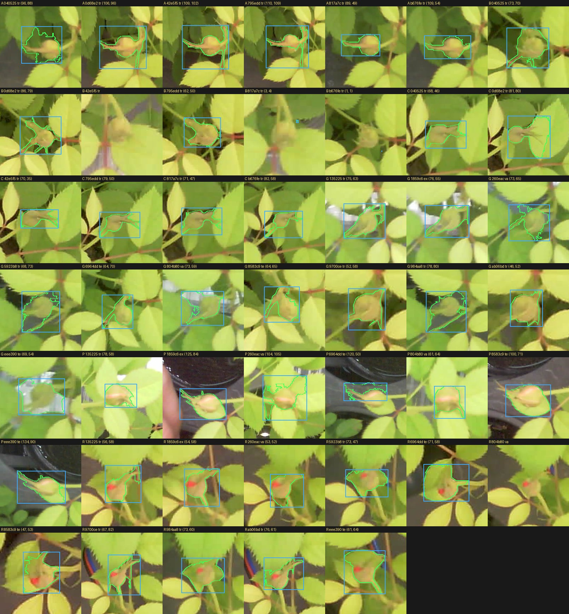
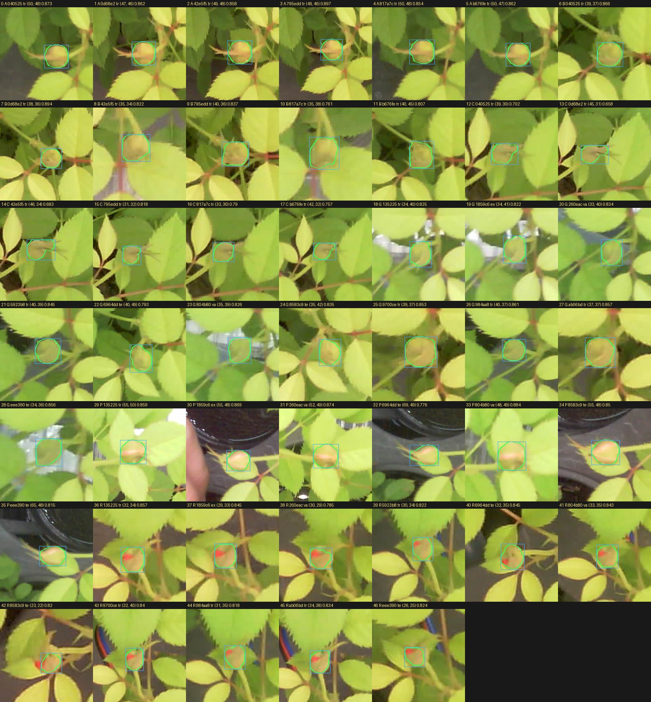
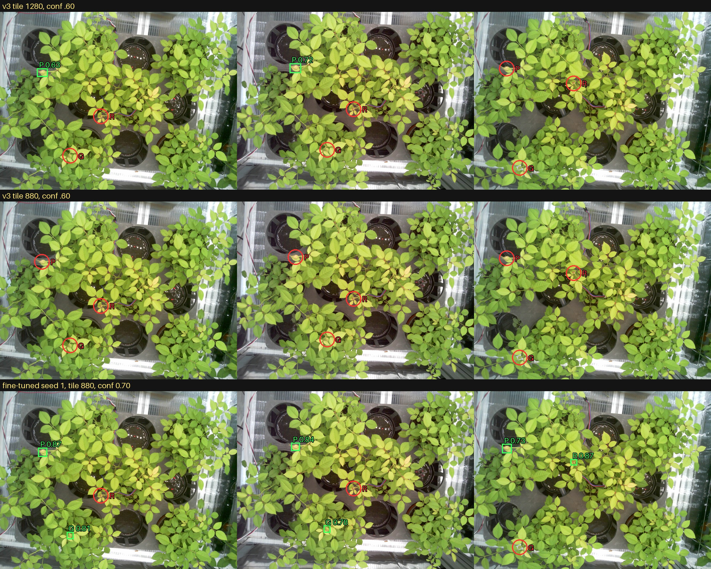

# 꽃 모델 v4 리포트: ESP 사진 파인튜닝

> 그림을 포함한 리포트: [REPORT.html](REPORT.html)

## 요약

- **사람이 라벨을 그린 ESP 사진으로 v3를 파인튜닝했습니다.** 사진 17장 중 학습 11장, 검증 2장, 평가 3장을 쓰고, 손이 찍힌 1장은 뺐습니다.
- **평가 사진에서 찾은 횟수가 늘었습니다.** 9번 중 v3 타일 1280은 2번, 타일 880은 0번, 파인튜닝은 시드에 따라 5, 6, 5번입니다. 다른 예측은 모두 0개입니다.
- **타일 880의 효과는 재현되지 않았습니다.** 이번 평가에서는 임계값 0.60에서 타일 880이 1280보다 낮고, 0.50에서는 같습니다.
- **휴대폰 성능은 떨어졌습니다.** 휴대폰 val 박스 mAP50이 0.96에서 0.79~0.85로 내려갔습니다. 이 가중치는 ESP 전용입니다.
- **새 봉오리에 대한 평가가 아닙니다.** 평가의 봉오리 3개는 모두 학습 사진에도 있어, 배치가 바뀌어도 같은 봉오리를 찾는다는 것까지만 말할 수 있습니다.
- **cameras.json과 v3는 바꾸지 않았습니다.** 어떤 모델을 쓸지도 아직 정하지 않았습니다.

## 데이터

| 용도 | 사진 | 내용 |
|---|---:|---|
| train | 11 | F-6의 6장, 왼쪽 화분이 잘 보이는 배치 5장 |
| val | 2 | 260eac, 804b80 |
| test | 3 | 6964dd, 8583c9, eee390. 잎이 왼쪽을 덮은 배치 |
| 제외 | 1 | 1859c6. 손이 찍혔고 평가와 배치가 겹칩니다 |

분리는 라벨을 그리기 전에 정했고, 1859c6만 학습 전 검수에서 뺐습니다. 라벨 페이지는 사진 순서를 섞고 용도를 보여 주지 않았습니다. 사람이 그린 상자는 47개이고 모두 봉오리입니다. 사진은 같은 트레이에서 찍었습니다. EXIF가 없어 촬영 시각은 확인하지 못했습니다.

## 라벨

사람이 그린 상자는 꽃받침과 여백을 포함해 모델 상자보다 컸습니다. F-6 사진의 봉오리 A에서 모델 상자와의 IoU는 0.26~0.40입니다. 라벨 페이지 안내에 꽃받침을 포함하라고 적은 것이 원인입니다.

상자를 그대로 SAM2.1에 넣으면 꽃받침과 잎까지 잡거나 비어 있었습니다. 그래서 상자 축소와 점 프롬프트로 후보를 여러 개 만들고, 가는 부분을 지운 뒤 가장 둥근 후보를 골랐습니다. 결과 47개는 Claude가 눈으로 확인해 모두 봉오리 몸통을 잡았습니다. 사용자는 아직 확인하지 않았습니다.

사진마다 달랐던 번호는 Claude가 생김새로 다시 맞췄습니다. F-6 사진은 A, B, C이고, 추가 사진은 P, R, G입니다. P는 A와 같아 보이지만, R과 G가 B, C 중 무엇인지는 판단하지 못했습니다.

## 학습

v3 A_base에서 시작해 ESP 사진만 학습했습니다. SGD, 학습률 0.002, 백본 10층 고정, 60에포크이고, 증강은 v3와 같습니다. 타일 880과 사진 전체 보기로 학습 타일 143장, 객체 78개, 검증 타일 26장, 객체 14개를 만들었습니다. 시드는 0, 1, 2입니다. 설정은 평가 전에 고정했고 다시 돌리지 않았습니다.

## 평가

찾음은 예측 상자의 중심이 사람이 그린 상자 안에 있는 경우이고, 봉오리 하나에 한 번만 셉니다. 다른 예측은 중심이 어떤 사람 상자에도 없는 예측입니다. IoU 0.5 열은 몸통 상자와 비교한 값입니다. v3 임계값은 기존 0.60이고, 파인튜닝 임계값은 검증 사진에서 찾음에서 다른 예측을 뺀 값이 가장 큰 임계값 중 가장 높은 값입니다.

| 조건 | 임계값 | 찾음 | 다른 예측 | IoU 0.5 | P | R | G |
|---|---:|---:|---:|---:|---:|---:|---:|
| v3, 타일 1280 | 0.60 | 2 / 9 | 0 | 1 | 2/3 | 0/3 | 0/3 |
| v3, 타일 880 | 0.60 | 0 / 9 | 0 | 0 | 0/3 | 0/3 | 0/3 |
| 파인튜닝 시드 0, 타일 880 | 0.75 | 5 / 9 | 0 | 5 | 2/3 | 1/3 | 2/3 |
| 파인튜닝 시드 1, 타일 880 | 0.70 | 6 / 9 | 0 | 6 | 3/3 | 1/3 | 2/3 |
| 파인튜닝 시드 2, 타일 880 | 0.70 | 5 / 9 | 0 | 5 | 3/3 | 1/3 | 1/3 |

임계값에 따른 찾은 횟수(다른 예측)입니다. 참고용이며 이 표로 임계값을 고르지 않습니다.

| 조건 | 0.20 | 0.30 | 0.40 | 0.50 | 0.60 | 0.70 |
|---|---:|---:|---:|---:|---:|---:|
| v3, 타일 1280 | 3 (1) | 3 (1) | 2 (1) | 2 (0) | 2 (0) | 1 (0) |
| v3, 타일 880 | 4 (5) | 2 (1) | 2 (0) | 2 (0) | 0 (0) | 0 (0) |
| 파인튜닝 시드 0, 타일 880 | 9 (3) | 9 (2) | 8 (0) | 6 (0) | 6 (0) | 6 (0) |
| 파인튜닝 시드 1, 타일 880 | 9 (2) | 9 (0) | 8 (0) | 7 (0) | 6 (0) | 6 (0) |
| 파인튜닝 시드 2, 타일 880 | 9 (2) | 9 (0) | 7 (0) | 7 (0) | 6 (0) | 5 (0) |

휴대폰 val 타일 결과입니다. 휴대폰 test는 열지 않았습니다.

| 모델 | 박스 mAP50 | 정밀도 | 재현율 | 마스크 mAP50 |
|---|---:|---:|---:|---:|
| v3 | 0.960 | 0.923 | 0.920 | 0.894 |
| ft_s0 | 0.835 | 0.745 | 0.758 | 0.760 |
| ft_s1 | 0.794 | 0.800 | 0.714 | 0.717 |
| ft_s2 | 0.853 | 0.759 | 0.831 | 0.784 |

## 한계

- **같은 봉오리입니다.** test의 P, R, G는 train에도 있습니다. 모델이 이 봉오리를 외웠을 수 있습니다.
- **표본이 작습니다.** test는 사진 3장, 봉오리 3개, 9번입니다.
- **검증이 쉬웠습니다.** val 2장은 train의 일부 사진과 배치가 비슷해 파인튜닝 모델이 모두 6/6이었습니다. 임계값 0.45~0.70이 동률이어서 규칙대로 가장 높은 값을 골랐고, 이 값이 test에서 찾은 횟수를 낮췄을 수 있습니다.
- **봉오리만 있습니다.** 개화중, 만개가 없어 큰 꽃과 단계 분류를 평가하지 못했습니다.
- **조명은 그대로입니다.** LED 상태를 바꾼 사진이 없습니다.
- **Jetson 시간을 재지 않았습니다.**
- **타일 880의 원인을 밝히지 못했습니다.** 왜 이번 평가에서 1280보다 낮은지 확인하지 않았습니다.
- **F-6 사진 2장은 가지도 움직인 것으로 보입니다.** 42e5f5, 817a7c에서 A와 C는 거의 그대로인데 B만 약 320px 움직였습니다. v3 리포트의 시점만 바꿨다는 설명은 이 점을 반영하지 않습니다.

## 다음 단계

- 다른 화분이나 새로 핀 봉오리 사진으로 평가합니다. 새 봉오리를 찾는지는 이 사진들로 알 수 없습니다.
- 꽃이 핀 상태와 LED 상태별 사진을 추가합니다.
- ESP 전용 가중치를 둘지, 휴대폰과 ESP 사진을 함께 학습할지 정합니다.
